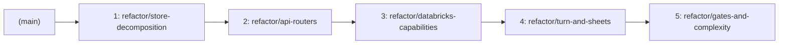

# Code Quality Audit & Deep Modularization Plan

> **Altitude**: A new senior engineer can read any module in `src/clawhouse/` and predict how the next one works; every change makes the codebase easier to change, not just bigger.

---

## 1. What an Expert Auditing This Codebase Would Look for (Unasked Questions)

When auditing a platform-agent runtime like Clawhouse, a top staff engineer looks beyond lint scores and line counters. The following critical system health dimensions were not explicitly requested but represent significant operational and maintenance risks:

1. **In-Memory Store Race Conditions vs. Postgres Semantics**:
   - `LakebaseSessionStore` relies on a PostgreSQL partial unique index (`runs_one_running_per_session`) to guarantee that two concurrent claims on the same session cannot both commit.
   - `MemorySessionStore` (`src/clawhouse/store/store.py:345-720`) implements identical operations for tests and local development using raw Python dictionaries (`dict[UUID, _MemorySession]`). However, its async methods do not use an `asyncio.Lock`. If two async tasks claim or mutate the same session during an await suspension, race conditions occur that cannot happen in production.
2. **Database Connection Lifecycle & OAuth Token Expiry**:
   - `LakebaseSessionStore` uses Databricks OAuth tokens minted via `WorkspaceClient` (`_mint_database_token` at `store.py:1690`).
   - Databricks OAuth tokens have an expiration lifetime (~1 hour). The connection pool connector (`_connector` at `store.py:1698`) creates connections on demand, but long-lived idle connections in `asyncpg.Pool` or pool re-connection during token expiration lack proactive health verification before executing queries.
3. **Leaky Error Boundaries & Platform Exception Exposure**:
   - Databricks SDK platform exceptions (`databricks.sdk.errors.platform.*`, HTTP 403, 404, 500) leak directly out of `src/clawhouse/capabilities/databricks.py` and into the agent tool execution stream without translation into structured domain errors.
   - When a warehouse is stopped or user lacks workspace permission, raw SDK stack traces bubble into tool outputs rather than deterministic recovery notices.
4. **God-Interface Sprawl (Violation of Interface Segregation Principle)**:
   - `SessionStore` (`store.py:200-309`) declares **34 public methods** on a single protocol. Every caller (`turn.py`, `app.py`, `schedules.py`, `jobs.py`) is coupled to this massive surface area.
   - Adding any persistence capability (e.g., custom agents, memories, approvals) forces modifications to `SessionStore`, `MemorySessionStore`, and `LakebaseSessionStore` simultaneously.
   - Dual-adapter synchronization risk: Keeping `MemorySessionStore` and `LakebaseSessionStore` in sync across 34 methods is high-friction manual labor. Any behavioral drift between in-memory regex and PostgreSQL SQL results in green tests that fail in production.
5. **Security & Privilege Escalation at Ambient Client Fallbacks**:
   - `DatabricksCapability` implements an ambient `WorkspaceClient()` fallback (Service Principal) when the forwarded user OAuth token lacks workspace write or warehouse enumeration permissions.
   - While ADR-0009 requires user-code execution to fail closed without ambient SP fallback, `_save_workspace_sql_file` (`databricks.py:703-713`) falls back to uploading files using the Service Principal. A compromised turn could potentially overwrite workspace files outside the user's personal directory.
6. **Test Suite Execution Latency**:
   - The test suite of 520 tests takes **91.5 seconds** to run locally.
   - Async sleeps, database retries, and comprehensive characterization tests slow down the TDD feedback loop. A healthy unit test suite of this size should finish in under 10 seconds.
7. **Test Assertions on Private Internals**:
   - Tests such as `tests/test_memory_api.py:106-110` reach directly into private class dictionaries (`assert store._sessions[own].owner_id == OWNER`) rather than asserting through public contracts.

---

## 2. Raw Evidence & Baseline Metrics

Audited against `src/` commit `4422e18` (all commands run in the active workspace).

### 2.1 Tool Execution Results

| Metric / Tool | Raw Command | Result / Baseline |
| :--- | :--- | :--- |
| **Cognitive Complexity (limit 15)** | `uv run complexipy src --max-complexity-allowed 15` | **Passed** (0 violations at threshold 15) |
| **Cognitive Complexity (limit 10)** | `uv run complexipy src --max-complexity-allowed 10` | **Failed: 20 functions exceed complexity 10** |
| **Dead Code (Vulture 80%)** | `uv run vulture src --min-confidence 80` | **0 dead code findings** |
| **Dead Code (Vulture 60%)** | `uv run vulture src --min-confidence 60` | **48 unused references** (mostly route functions & capability hooks) |
| **Code Duplication (jscpd)** | `npx jscpd@5 src --threshold 3 --min-lines 5 --min-tokens 50` | **Overall: 0.93% lines (155 lines), 1.07% tokens (1084 tokens)**<br>Python: 0.44% lines (44 lines), 0.56% tokens (320 tokens), 5 clones |
| **Type Check & Strictness** | `uv run pyright` | **0 errors, 3 warnings in tests** (`_sessions` private usage)<br>11 occurrences of `# type: ignore`<br>72 occurrences of `Any` |
| **Lint Gate (Ruff default)** | `uv run ruff check .` | **Passed** |
| **Lint Gate (Ruff preview rules)** | `uv run ruff check src --select C901,PLR0911,PLR0912,PLR0913,PLR0914,PLR0915,PLR1702 --preview` | **6 errors**: 5 functions with > 3 nested blocks (`PLR1702`), 1 function with > 10 locals (`PLR0914`) |
| **Test Suite Status** | `uv run pytest` | **511 passed, 9 skipped in 91.49s** |
| **Frontend Gates** | `npm run typecheck && npm test` | **Passed: 15 test files, 135 component tests passed** |

### 2.2 Worst Cognitive Complexity Offenders (Limit 10)

```
Score  Function / Method                            Location
-------------------------------------------------------------------------------------------------
  15   drop_unreturned_tool_calls                   src/clawhouse/agent/history.py:31
  15   load_bootstrap                               src/clawhouse/capabilities/bootstrap.py:27
  15   scrub_object                                 src/clawhouse/capabilities/mcp.py:118
  14   _slash_suggestions                           src/clawhouse/api/app.py:1090
  14   DatabricksTools::_save_workspace_sql_file    src/clawhouse/capabilities/databricks.py:681
  14   setup_mlflow_tracing                         src/clawhouse/telemetry.py:107
  13   _persist_and_emit                            src/clawhouse/agent/turn.py:1008
  13   DatabricksTools::jobs_create                 src/clawhouse/capabilities/databricks.py:758
  13   jobs_identity                                src/clawhouse/capabilities/databricks.py:58
  12   _memory_routes                               src/clawhouse/api/app.py:332
  12   DatabricksTools::_build_sql_task             src/clawhouse/capabilities/databricks.py:716
  12   DatabricksTools::dbsql_query                 src/clawhouse/capabilities/databricks.py:582
  12   DatabricksTools::jobs_get_run                src/clawhouse/capabilities/databricks.py:947
  11   select_model                                 src/clawhouse/agent/model.py:47
  11   _fit_total                                   src/clawhouse/agent/turn.py:76
  11   _task_outputs                                src/clawhouse/capabilities/databricks.py:265
  11   levels_for                                   src/clawhouse/capabilities/jobs.py:77
  11   disambiguate_tool_names                      src/clawhouse/capabilities/mcp.py:84
  11   _find_summary_text                           src/clawhouse/capabilities/mentions.py:175
  11   _read_skill_instructions                     src/clawhouse/capabilities/skills.py:9
```

### 2.3 Git Churn Analysis

Top changed files in commit history (including previous repository name `crabriks`):

```
Commits  File
-------------------------------------------------------------------------------------------------
  30     src/clawhouse/api/app.py (and src/crabriks/api/app.py)
  29     src/clawhouse/agent/turn.py (and src/crabriks/agent/turn.py)
  23     frontend/chat.ts
  19     tests/test_turn.py
  18     src/clawhouse/store/store.py (and src/crabriks/store/store.py)
  17     tests/test_chat.py
  12     tests/test_lakebase.py
  11     tests/test_jobs_tools.py
  10     src/clawhouse/capabilities/databricks.py
  10     frontend/chat.test.ts
```

Largest recent commits:
- Commit `4422e18`: Jobs screen backend + frontend (+1,354 / -26 lines)
- Commit `acec76b`: `ask_user` interaction cards (+1,440 / -104 lines)
- Commit `46e8a75`: Progress cards (+768 / -100 lines)
- Commit `35389f4`: `@agent` per-message routing (+558 / -95 lines)

### 2.4 Files Over 400 Lines (Sorted by Line Count)

```
Lines  File Path                                   % of Total Python Codebase
-------------------------------------------------------------------------------------------------
 1805  src/clawhouse/store/store.py                18.0%
 1589  src/clawhouse/api/app.py                    15.8%
 1418  src/clawhouse/capabilities/databricks.py    14.1%
 1170  src/clawhouse/agent/turn.py                 11.6%
  459  src/clawhouse/capabilities/sheets.py         4.6%
-------------------------------------------------------------------------------------------------
 6441  Total lines in files > 400 lines            64.1% of entire Python code
```

All other 24 Python files in `src/` are under 400 lines (median: 114 lines).

### 2.5 Functions Over 50 Lines (Sorted by Line Count)

```
Lines  Location                                              Function Name
-------------------------------------------------------------------------------------------------
   72  src/clawhouse/capabilities/agent_tools.py:53-124      get_toolset
   69  src/clawhouse/api/app.py:1019-1087                    _schedule_routes
   66  src/clawhouse/capabilities/databricks.py:758-823      jobs_create
   66  src/clawhouse/api/app.py:1175-1240                    _composer_routes
   64  src/clawhouse/capabilities/agent_tools.py:59-122      create_agent (nested in get_toolset)
   64  src/clawhouse/api/app.py:1177-1240                    composer_suggestions (in _composer_routes)
   63  src/clawhouse/api/app.py:332-394                      _memory_routes
   57  src/clawhouse/store/store.py:730-786                  migrate
```

*Note*: Only **8 functions** in the entire codebase exceed 50 lines.

---

## 3. Challenging Assumptions: What the Data Actually Proves

The initial intuition was that the codebase suffers from sprawling, bloated functions, rampant duplication, and ubiquitous type holes. The raw data tells a fundamentally different story:

1. **Monolithic Functions vs. Monolithic Files**:
   - *Assumption*: Functions are oversized and need aggressive line cutting.
   - *Data*: Only 8 functions in the entire codebase exceed 50 lines! Almost every function is already broken down into small units (20–40 lines).
   - *Reality*: The problem is **file-level bloat and interface sprawl**. Four files (`store.py`, `app.py`, `databricks.py`, `turn.py`) contain **5,982 lines** (60% of the entire codebase). Developers are not struggling with 200-line functions; they are struggling to navigate 1,800-line files where 5 distinct architectural responsibilities are intertwined.
2. **Duplication is NOT the Culprit**:
   - *Assumption*: Duplication needs to be driven below 1%.
   - *Data*: Python duplication is already at **0.44%** (5 clones across 10,052 lines). Total duplication including CSS and JS is **0.93%**.
   - *Reality*: The code is not copy-pasted; it is **hyper-coupled**. When a feature is added (e.g. `ask_user` or `@agent`), it forces simultaneous modifications across `app.py`, `turn.py`, `store.py`, and `databricks.py` (shotgun surgery). Git churn data confirms this pattern: those 4 files are edited in nearly every commit.
3. **Type Holes (`Any` vs. `type: ignore`)**:
   - *Assumption*: `type: ignore` comments are widespread.
   - *Data*: There are only 11 `type: ignore` comments in the codebase.
   - *Reality*: The type holes exist as **72 `Any` annotations** and stringly-typed dictionaries (`dict[str, Any]` in sheets, databricks, and composer suggestions). The root causes are:
     - The Databricks Python SDK returning dynamic objects or untyped response shapes.
     - Pydantic AI's `RunContext[Any]` and capability toolsets accepting `AbstractCapability[Any]`.
     - JSON-RPC payloads in `sheets.py` treated as nested untyped dicts.
4. **Slicing by Line Count vs. Deep Domain Modules**:
   - *Assumption*: Split files that exceed 400 lines.
   - *Reality*: Blindly splitting `store.py` (1,805 lines) into 5 files of 360 lines based on line count creates shallow pass-through modules, cyclical imports, and fragmented interfaces. Modules must be split along **natural domain seams** (schema, connection pooling, mappers, in-memory adapter, Lakebase adapter) so each module has high depth: small interface, rich implementation.

---

## 4. Range: Methodological Lenses

### 4.1 The Editor: Module Narratives
Each module must tell a single, coherent story. Anything extraneous is cut:
- `src/clawhouse/api/app.py`: Tells 7 distinct stories (serving static files from disk, formatting SSE frames, routing session CRUD, handling approval webhooks, managing custom agents, parsing quartz schedules, and generating composer autocomplete). It must be trimmed to app composition and router mounting; each story moves to its own router.
- `src/clawhouse/capabilities/databricks.py`: Tells 6 stories (parsing SQL comments, converting Quartz cron strings, querying SQL Warehouses, inspecting Unity Catalog lineage, creating Lakeflow jobs, and running single-node Python tasks).
- `src/clawhouse/agent/turn.py`: Tells 5 stories (defining event dataclasses, parsing Pydantic AI stream events, claiming session locks, managing SSE generator queues, and executing agent models).

### 4.2 The Architect & Urban Planner: Layered Seams & Boundary Rules
Strict layer boundaries are established. Imports may only flow downward; upward or circular imports are forbidden:

```
┌────────────────────────────────────────────────────────┐
│                      api/                              │  Presentation (HTTP, SSE, Schemas)
└──────────────────────────┬─────────────────────────────┘
                           │
                           ▼
┌────────────────────────────────────────────────────────┐
│                     agent/                             │  Orchestration (Turn loop, Roster, Persona)
└─────────────┬───────────────────────────┬──────────────┘
              │                           │
              ▼                           ▼
┌──────────────────────────┐    ┌────────────────────────┐
│      capabilities/       │    │        store/          │  Integrations & Persistence
└──────────────────────────┘    └────────────────────────┘
```

**Non-Negotiable Seam Rules**:
1. `store/` must NEVER import from `agent/`, `capabilities/`, or `api/`.
2. `capabilities/` must NEVER import from `agent/` or `api/`.
3. `api/` must call `agent/turn.py` and `store/`, never reaching directly into capability internal plumbing.
4. `agent/` talks to external services strictly via Pydantic AI capabilities/toolsets.

### 4.3 The Typographer & Designer: Visual Rhythm & Layout
- **Visual Rhythm**: Functions should read like well-spaced paragraphs, not dense walls of code.
- **Guard Clauses & Early Returns**: Eliminate deep nesting (3+ levels). Never wrap an entire 40-line function body in an `if` or `try` block when an early return or guard condition can flatten the indentation.
- **Consistent Symmetry**: `iter_turn` and `iter_resume_turn` in `turn.py` have identical queue draining and task detachment structures, yet differ slightly in error logging and formatting. Standardize on symmetrical helpers.

### 4.4 The Red Team: Vibe-Coded Patterns Catalog

The audit uncovered several classic AI-generated / "vibe-coded" patterns:

1. **4-Level Defensive Try/Except with Swallowed Errors**:
   - `src/clawhouse/capabilities/databricks.py:700-714`:
     ```python
     try:
         _do_upload(target_client)
     except Exception as exc:
         if client is None:
             fallback = self._fallback_client()
             if fallback is not None and fallback is not target_client:
                 try:
                     _do_upload(fallback)
                 except Exception as fb_exc:  # noqa: BLE001
                     raise RuntimeError(...) from exc
     ```
     *Issue*: Nested defensive fallbacks with suppressed exceptions and blanket catch.
2. **Blind Error Suppression with `suppress`**:
   - `src/clawhouse/capabilities/mcp.py:142`:
     ```python
     with suppress(AttributeError, TypeError):
         for k, v in list(vars(obj).items()):
     ```
     *Issue*: Blindly silencing object attribute access errors during reflection.
3. **Exception Logging Without Traceback or Re-raise**:
   - `src/clawhouse/capabilities/schedules.py:179-182`:
     ```python
     except Exception as exc:  # noqa: BLE001
         logger.error("scheduled turn failed: %s", type(exc).__name__)
     ```
     *Issue*: Swallows exceptions in background worker loop, logging only the type name without traceback or alerting.
4. **Near-Duplicate Functions (jscpd Clones)**:
   - `src/clawhouse/agent/turn.py:294-314` (`iter_turn`) vs. `src/clawhouse/agent/turn.py:317-341` (`iter_resume_turn`): 14 duplicate lines handling background worker detachment and queue draining.
   - `src/clawhouse/store/store.py:648-656` vs. `store.py:991-999`: Duplicate memory persistence logic between `MemorySessionStore` and `LakebaseSessionStore`.
   - `src/clawhouse/api/app.py:638-643` vs. `app.py:1259-1264`: Duplicate `SessionForbidden` / `SessionNotFound` exception handling.
5. **Stringly-Typed Dictionaries Over Typed Models**:
   - `src/clawhouse/capabilities/sheets.py:192, 207, 241, 272, 331`: 14 functions accepting or returning `dict[str, Any]` instead of Pydantic models.
   - `src/clawhouse/api/app.py:1090, 1132, 1184`: `_slash_suggestions` and `_at_suggestions` returning unstructured dicts.
6. **Repeated Type Ignores on Untyped Dynamic Access**:
   - `src/clawhouse/api/app.py:399-403`: Five consecutive `# type: ignore[attr-defined]` comments because a database row object was untyped.
   - `src/clawhouse/capabilities/mentions.py:323, 328`: `# type: ignore[attr-defined]` on `store.save_memory` and `store.rank_memories`.
7. **Tests Asserting Implementation Internals**:
   - `tests/test_memory_api.py:106, 107, 110`: Asserting directly on private attribute `store._sessions` instead of using public store methods.

---

## 5. Detailed Findings (with File and Line Citations)

### 5.1 Long Files & Domain Decomposition Plan

Each file over 400 lines is analyzed into its mixed responsibilities and mapped to new, deep modules under 400 lines:

#### 1. `src/clawhouse/store/store.py` (1,805 lines)
- **Mixed Responsibilities**:
  1. SQL Schema DDL strings and database migrations (`SCHEMA` SQL, `migrate`: lines 45–198, 730–786).
  2. Protocol contract declaration (`SessionStore`: lines 200–309, 34 methods).
  3. In-memory dictionary store implementation for tests (`MemorySessionStore`: lines 345–720).
  4. PostgreSQL/asyncpg production store implementation (`LakebaseSessionStore`: lines 723–1419).
  5. Row-to-domain shape mappers (`_entry_from_row`, `_approval_from_row`, etc.: lines 1422–1583).
  6. Databricks OAuth token minting, connection pooling, retry logic (`connection_plan`, `connect_pool`, `_mint_database_token`: lines 1621–1804).
- **Split Plan (Target Modules)**:
  - `src/clawhouse/store/protocol.py` (~120 lines): `SessionStore` protocol and exceptions (`RunNotActive`, `ApprovalPending`, etc.).
  - `src/clawhouse/store/schema.py` (~180 lines): DDL schema strings and `migrate()` runner.
  - `src/clawhouse/store/mappers.py` (~130 lines): Pure row-to-shape parsing functions.
  - `src/clawhouse/store/connection.py` (~160 lines): Databricks OAuth token minting, pool creation, and retry logic.
  - `src/clawhouse/store/memory.py` (~380 lines): In-memory `MemorySessionStore`.
  - `src/clawhouse/store/lakebase.py` (~390 lines): Production `LakebaseSessionStore`.
  - `src/clawhouse/store/__init__.py` (~50 lines): Facade re-exporting public symbols (`open_store`, `SessionStore`, etc.).

#### 2. `src/clawhouse/api/app.py` (1,589 lines)
- **Mixed Responsibilities**:
  1. API request/response schemas (20 Pydantic models: lines 97–252).
  2. Static file serving with cache-control headers (lines 424–541).
  3. Session CRUD and turn streaming orchestration (lines 544–675, 1294–1337).
  4. Human approvals and question-answering endpoints (lines 718–829, 1340–1377).
  5. Custom agent roster CRUD (lines 892–1016).
  6. Schedule management routes (lines 1019–1087).
  7. Composer suggestions and mention autocompletion (lines 1090–1240).
  8. SSE wire protocol encoding and formatting (lines 1419–1508).
- **Split Plan (Target Modules)**:
  - `src/clawhouse/api/schemas.py` (~160 lines): All Pydantic request and response models.
  - `src/clawhouse/api/sse.py` (~110 lines): SSE event serialization, encoding, and notice formatting.
  - `src/clawhouse/api/routes/assets.py` (~90 lines): Static file and shell HTML serving.
  - `src/clawhouse/api/routes/sessions.py` (~230 lines): Session CRUD, transcript retrieval, turn streaming trigger.
  - `src/clawhouse/api/routes/approvals.py` (~130 lines): Approvals and question resolution routes.
  - `src/clawhouse/api/routes/agents.py` (~110 lines): Custom agent endpoints.
  - `src/clawhouse/api/routes/schedules.py` (~90 lines): Schedule endpoints.
  - `src/clawhouse/api/routes/suggestions.py` (~120 lines): Composer autocomplete endpoints.
  - `src/clawhouse/api/routes/status.py` (~80 lines): Status and hatch diagnostics.
  - `src/clawhouse/api/app.py` (~120 lines): FastAPI initialization, dependency injection, and router mounting.

#### 3. `src/clawhouse/capabilities/databricks.py` (1,418 lines)
- **Mixed Responsibilities**:
  1. SQL query validation, comment stripping, limit enforcement (lines 123–146).
  2. Cron expression translation to Quartz cron format (lines 149–182).
  3. SQL Warehouse query execution and `ai_query` evaluation (lines 435–449, 582–631).
  4. Unity Catalog schema/table discovery, permissions, and lineage (lines 530–580, 1150–1200).
  5. Lakeflow Jobs lifecycle: creation, editing, task building, run polling, output retrieval (lines 633–1091).
  6. Python analysis on single-node cluster (lines 1215–1317).
  7. Toolset aggregation and Pydantic AI Capability adapter (lines 1319–1417).
- **Split Plan (Target Modules)**:
  - `src/clawhouse/capabilities/databricks/sql_util.py` (~60 lines): SQL parsing and safety checks.
  - `src/clawhouse/capabilities/databricks/cron_util.py` (~60 lines): Quartz cron translation.
  - `src/clawhouse/capabilities/databricks/warehouse.py` (~150 lines): SQL Warehouse queries and warehouse discovery.
  - `src/clawhouse/capabilities/databricks/catalog.py` (~210 lines): Unity Catalog exploration, permissions, and lineage.
  - `src/clawhouse/capabilities/databricks/jobs_client.py` (~360 lines): Lakeflow Jobs creation, edition, and output parsing.
  - `src/clawhouse/capabilities/databricks/python_analysis.py` (~120 lines): Single-node cluster Python task runner.
  - `src/clawhouse/capabilities/databricks/tools.py` (~240 lines): `DatabricksTools` public interface.
  - `src/clawhouse/capabilities/databricks/capability.py` (~70 lines): `DatabricksCapability` adapter.
  - `src/clawhouse/capabilities/databricks/__init__.py` (~40 lines): Facade re-exporting tools and capabilities.

#### 4. `src/clawhouse/agent/turn.py` (1,170 lines)
- **Mixed Responsibilities**:
  1. Turn notice dataclasses (`Token`, `ToolCallNotice`, `ApprovalNotice`, etc.: lines 121–211).
  2. TurnContext and session claim locking (lines 231–291, 344–394).
  3. Background task detachment and async queue draining (`_worker`, `_drain`, `_detach`: lines 397–463).
  4. Model invocation and Pydantic AI agent loop execution (lines 570–700, 795–832).
  5. Human approval and question pause handling (lines 862–925).
  6. Notice event parsing and token scrubbing (lines 955–1041, 1087–1140).
- **Split Plan (Target Modules)**:
  - `src/clawhouse/agent/notices.py` (~100 lines): Immutable notice dataclasses.
  - `src/clawhouse/agent/events.py` (~130 lines): Pydantic AI stream event parsing and token scrubbing.
  - `src/clawhouse/agent/pauses.py` (~150 lines): Approval and question pause/resume handlers.
  - `src/clawhouse/agent/lifecycle.py` (~210 lines): Session claim locking, background worker detachment, queue draining.
  - `src/clawhouse/agent/runner.py` (~240 lines): Model runner, prompt assembly, and capability injection.
  - `src/clawhouse/agent/turn.py` (~120 lines): Facade exposing `run_turn`, `resume_turn`, `iter_turn`, etc.

#### 5. `src/clawhouse/capabilities/sheets.py` (459 lines)
- **Mixed Responsibilities**:
  1. A1 range notation math and 2D table validation (lines 53–135).
  2. Databricks HTTP gateway client and authorization (lines 138–269).
  3. JSON-RPC payload parsing, validation, and error translation (lines 272–397).
  4. Toolset and Capability wrapper (lines 400–459).
- **Split Plan (Target Modules)**:
  - `src/clawhouse/capabilities/sheets/geometry.py` (~80 lines): A1 range parsing and rectangular table validation.
  - `src/clawhouse/capabilities/sheets/gateway.py` (~160 lines): HTTP gateway client and JSON-RPC exchange.
  - `src/clawhouse/capabilities/sheets/tools.py` (~140 lines): Pydantic AI tools and capability adapter.
  - `src/clawhouse/capabilities/sheets/__init__.py` (~30 lines): Facade re-exporting tools and capability.

---

### 5.2 Hard-to-Read Code & Code Smells

#### Deep Nesting (3+ Levels) — Ruff Rule `PLR1702`
1. `src/clawhouse/capabilities/databricks.py:700`: `_save_workspace_sql_file` nests 4 levels: `try` -> `except` -> `if` -> `if` -> `try`. Flatten with a dedicated upload helper.
2. `src/clawhouse/capabilities/mcp.py:91`: `disambiguate_tool_names` nests 4 levels: `for` -> `if/else` -> `while` -> `if`. Extract suffix generator into a separate generator function.
3. `src/clawhouse/capabilities/mcp.py:142`: `_scrub_dict_object` nests 4 levels: `with` -> `for` -> `if` -> `if`. Replace with explicit dictionary traversal.
4. `src/clawhouse/capabilities/mentions.py:177`: `_find_summary_text` nests 4 levels: `for` -> `if` -> `for` -> `if`. Extract a generator expression.
5. `src/clawhouse/capabilities/schedules.py:166`: `run_schedule_worker` nests 4 levels: `while` -> `try` -> `for` -> `try`. Split batch execution into `_process_due_batch()`.

#### Long Parameter Lists (> 5 Parameters) — Ruff Rule `PLR0913`
1. `src/clawhouse/capabilities/databricks.py:758`: `jobs_create` has **11 parameters** (`task_type`, `path`, `parameters`, `warehouse_id`, `query`, `agent_name`, `instructions`, `cron_expression`, `timezone_id`, `pause_status`). Group into a typed configuration model `JobCreateSpec`.
2. `src/clawhouse/agent/prompt.py:47`: `build_system_prompt` has **9 parameters**. Group into `PromptContext`.
3. `src/clawhouse/capabilities/databricks.py:866`: `jobs_edit` has **9 parameters**. Group into `JobEditSpec`.
4. `src/clawhouse/agent/turn.py:795`: `_invoke_agent` has **8 parameters**. Pass `TurnContext` and runner state.
5. `src/clawhouse/capabilities/databricks.py:716`: `_build_sql_task` has **7 parameters**. Group task options.
6. `src/clawhouse/capabilities/workspace.py:52`: `provision_agent_workspace` has **7 parameters**.

#### High Cognitive Complexity (> 10) — Complexipy
- `src/clawhouse/agent/history.py:31` (`drop_unreturned_tool_calls`, score 15): Complex while/for loops matching tool calls to tool results. Refactor using a two-pass partition.
- `src/clawhouse/capabilities/bootstrap.py:27` (`load_bootstrap`, score 15): Complex truncation, fallback, and fitting logic. Split source loading from budget fitting.
- `src/clawhouse/capabilities/mcp.py:118` (`scrub_object`, score 15): Recursive reflection over Pydantic, dataclasses, dicts, and objects. Move token scrubbing to a dedicated utility with pattern-matched dispatch.
- `src/clawhouse/api/app.py:1090` (`_slash_suggestions`, score 14): Hardcoded command lists mixed with filesystem scanning. Separate static command lookup from skill directory discovery.

---

## 6. Rules That Enforce Themselves

### 6.1 One Sentence per Module: Boundary & Forbidden Action

| Module | Boundary (What It Does) | What It Must NOT Do |
| :--- | :--- | :--- |
| `clawhouse.store.protocol` | Declares the abstract `SessionStore` contract and domain storage errors. | Must not perform I/O, connect to databases, or contain SQL statements. |
| `clawhouse.store.connection` | Mints Databricks OAuth tokens and manages the asyncpg connection pool lifecycle. | Must not execute application domain queries or manage sessions. |
| `clawhouse.store.schema` | Defines SQL DDL schemas and executes database migrations. | Must not handle runtime queries, sessions, or transcripts. |
| `clawhouse.store.mappers` | Purely converts database rows and dicts into domain dataclass shapes. | Must not perform I/O, mutate database state, or log. |
| `clawhouse.store.memory` | Provides an in-memory simulation of `SessionStore` for unit tests and local dev. | Must not import asyncpg or Databricks SDK. |
| `clawhouse.store.lakebase` | Implements `SessionStore` using asyncpg queries against Databricks Lakebase Postgres. | Must not mint OAuth tokens directly or alter schemas at runtime. |
| `clawhouse.api.schemas` | Defines Pydantic request and response models for HTTP and SSE endpoints. | Must not contain route handler logic, database queries, or agent calls. |
| `clawhouse.api.sse` | Formats and encodes Server-Sent Events frames into byte streams for HTTP responses. | Must not execute database queries or call agent models. |
| `clawhouse.api.routes.*` | Handles HTTP requests, validates auth, and dispatches to stores or agent turn loop. | Must not contain raw SQL, format SSE frames, or execute model streaming directly. |
| `clawhouse.agent.notices` | Declares immutable dataclasses representing turn events (tokens, tools, cards). | Must not contain business logic, I/O, or parsing code. |
| `clawhouse.agent.events` | Translates Pydantic AI stream events into sanitized `TurnNotice` instances. | Must not manage async queues, locks, or database persistence. |
| `clawhouse.agent.pauses` | Orchestrates approval and question pause/resume state transitions. | Must not stream tokens or execute LLM model calls. |
| `clawhouse.agent.lifecycle` | Manages session run locks, worker background task detachment, and queue draining. | Must not assemble system prompts or select models. |
| `clawhouse.agent.runner` | Assembles agent capabilities, prompts, and executes the Pydantic AI run loop. | Must not manage HTTP streaming, SSE encoding, or database connection pools. |
| `clawhouse.capabilities.databricks.warehouse` | Executes SQL statements and `ai_query` on Databricks SQL Warehouses. | Must not manage Lakeflow Jobs or alter Unity Catalog grants. |
| `clawhouse.capabilities.databricks.catalog` | Queries Unity Catalog schemas, tables, permissions, and data lineage. | Must not execute arbitrary user SQL or create jobs. |
| `clawhouse.capabilities.databricks.jobs_client` | Creates, edits, runs, and monitors Databricks Lakeflow Jobs. | Must not query SQL Warehouses directly or serve HTTP requests. |
| `clawhouse.capabilities.sheets` | Provides Google Sheets read/write tools via Databricks HTTP gateway. | Must not manage Lakeflow jobs or Databricks SQL warehouses. |

### 6.2 "Good-Looking Code" for This Repo (AGENTS.md Candidate)

```markdown
### Good-looking code in Clawhouse

- **Early returns first**: Guard clauses handle errors, empty checks, and bounds at the top; the happy path has zero indentation.
- **Small named helpers**: One level of abstraction per function; break nested blocks and loops into small, focused pure functions.
- **Typed models over dicts**: Frozen dataclasses or Pydantic models for every boundary; zero untyped `dict[str, Any]` across modules.
- **Ruff layout**: Target 100 chars, double quotes, no trailing commas when fitting one line, strict standard imports (`I`).
- **Deep modules**: Hide complex operations behind a minimal interface; caller learns 1 function, gets full leverage.
```

### 6.3 Automated Enforcement Gates

Once code refactoring is complete, the following gates will be locked into configuration:

1. **Ruff Rules (`pyproject.toml`)**:
   ```toml
   [tool.ruff.lint]
   extend-select = [
       "C901",    # McCabe cyclomatic complexity (<= 9)
       "PLR0912", # Max branches (<= 8)
       "PLR0913", # Max function arguments (<= 5)
       "PLR1702", # Max nested blocks (<= 3, requires preview)
   ]
   ```
2. **File and Function Length Gate (`pre-commit` hook)**:
   Add a fast local pre-commit hook (Python AST pass) checking:
   - Maximum file length: **400 lines**.
   - Maximum function length: **50 lines**.
   - Strict pass on all new/modified files.
3. **Complexipy Threshold**:
   - Lower from `--max-complexity-allowed=15` to `--max-complexity-allowed=10`.
4. **Shrinking Allowlist**:
   - Legacy functions currently exceeding complexity 10 or length 50 are placed in an allowlist file `.quality-allowlist.json`.
   - The CI gate asserts: `current_violations <= allowlist_count`, and fails if a new violation is added or if an existing violation is removed without updating the baseline.

---

## 7. Outside Judge & Verification Invariants

1. **Objective Metrics (Before vs. After Target)**:

| Metric | Before (Today) | After Target | Verification Command |
| :--- | :--- | :--- | :--- |
| **Max File Length** | 1,805 lines (`store.py`) | **< 400 lines** (all files) | AST / `wc -l` gate |
| **Max Function Length** | 72 lines (`get_toolset`) | **< 50 lines** (all functions) | AST gate |
| **Max Cognitive Complexity** | 15 (3 functions) | **<= 10** | `uv run complexipy src --max-complexity-allowed 10` |
| **Code Duplication** | 0.93% overall (0.44% Python) | **< 1.0% overall (< 0.5% Python)** | `npx jscpd@5 src --threshold 3` |
| **Type Holes (`Any`)** | 72 occurrences | **Zero in new/modified code; existing shrinking** | `git grep -n "\bAny\b" src/` |
| **Type Holes (`type: ignore`)** | 11 occurrences | **0 in new code; legacy eliminated** | `git grep -n "type: ignore" src/` |
| **Allowlist Size** | 20 complexity violations | **0 (empty allowlist)** | CI quality gate |

2. **Behavioral Invariants**:
   - `make check` is green at every single commit.
   - All 520 tests pass without modification (no behavior change, no test relaxation).
   - All 135 frontend component tests pass.
   - External review protocol: Each PR must be verified in a fresh subagent / session against `AGENTS.md` and the module boundaries defined above.

---

## 8. Implementation Plan: 5-PR Stack (`gh stack`)

The refactoring is aggregated into 5 reviewable layers in a linear `gh stack`. Foundational persistence and presentation decoupling are placed at the bottom, capability and turn refactorings in the middle, and complexity refactoring plus automated gate enforcement at the top.



### Layer 1: `refactor/store-decomposition` (Store Decoupling & Adapters)
- **Scope**:
  - Decompose `src/clawhouse/store/store.py` (1,805 lines) into:
    - `protocol.py`: Protocol `SessionStore` and domain exceptions (~120 lines).
    - `schema.py`: SQL DDL schemas and `migrate()` function (~180 lines).
    - `connection.py`: Databricks OAuth token minting, asyncpg pool connection, retry logic (~160 lines).
    - `mappers.py`: Pure row-to-shape parsing functions (~130 lines).
    - `memory.py`: In-memory `MemorySessionStore` (~380 lines).
    - `lakebase.py`: Production `LakebaseSessionStore` (~390 lines).
    - `store.py` / `__init__.py`: Thin facade re-exporting public API (~50 lines).
- **Invariants**: All 520 tests pass untouched; `store.py` drops from 1,805 lines to < 50 lines; zero behavior change.
- **Verification**: `uv run pytest tests/test_store_connect.py tests/test_lakebase.py tests/test_memory_api.py` and `uv run pyright`.

### Layer 2: `refactor/api-routers` (FastAPI Routers & Composition)
- **Scope**:
  - Decompose `src/clawhouse/api/app.py` (1,589 lines) into:
    - `schemas.py`: All Pydantic request and response models (~160 lines).
    - `sse.py`: Server-Sent Events framing, JSON serialization, and notice formatting (~110 lines).
    - `routes/assets.py`: Static files, stylesheets, scripts, and HTML shell serving (~90 lines).
    - `routes/sessions.py`: Session CRUD, transcript retrieval, turn streaming trigger (~230 lines).
    - `routes/approvals.py`: Approval resolution and Question answer handling (~130 lines).
    - `routes/agents.py`: Custom agent listing, creation, and deletion (~110 lines).
    - `routes/schedules.py`: Scheduled turns listing, creation, and cancellation (~90 lines).
    - `routes/suggestions.py`: Composer slash commands and mention completions (~120 lines).
    - `routes/status.py`: App status, workspace health, and hatch profile (~80 lines).
    - `app.py`: Clean FastAPI initialization, middleware, dependency injection, and router mounting (~120 lines).
- **Invariants**: All API endpoints maintain identical paths, payloads, and SSE wire format.
- **Verification**: `tests/test_chat.py`, `tests/test_suggestions_api.py`, `tests/test_shell.py`, `tests/test_memory_api.py`.

### Layer 3: `refactor/databricks-capabilities` (Databricks Domain Splitting)
- **Scope**:
  - Convert `src/clawhouse/capabilities/databricks.py` (1,418 lines) into package `src/clawhouse/capabilities/databricks/`:
    - `sql_util.py`: Pure SQL comment stripping, readonly query checking, limit enforcement (~60 lines).
    - `cron_util.py`: Quartz cron translation and schedule builder (~60 lines).
    - `warehouse.py`: SQL Warehouse resolution, DBSQL query execution, and `ai_query` evaluation (~150 lines).
    - `catalog.py`: Unity Catalog schema discovery, table descriptions, permissions/grants, and lineage queries (~210 lines).
    - `jobs_client.py`: Lakeflow Jobs creation, edition, cancellation, task builders, and output extraction (~360 lines).
    - `python_analysis.py`: Single-node cluster Python task submission and result polling (~120 lines).
    - `tools.py`: `DatabricksTools` aggregator exposing the tool methods (~240 lines).
    - `capability.py`: `DatabricksCapability` adapter (~70 lines).
    - `__init__.py`: Backwards-compatible facade (~40 lines).
- **Invariants**: Tool signatures and docstrings exposed to Pydantic AI remain identical.
- **Verification**: `tests/test_databricks_tools.py`, `tests/test_jobs_tools.py`, `tests/test_estate_tools.py`, `tests/test_run_python_analysis.py`.

### Layer 4: `refactor/turn-and-sheets` (Turn Loop & Google Sheets)
- **Scope**:
  - Decompose `src/clawhouse/agent/turn.py` (1,170 lines) into:
    - `notices.py`: Turn notice dataclasses (`Token`, `ToolCallNotice`, `ApprovalNotice`, etc.) (~100 lines).
    - `events.py`: Parsing Pydantic AI stream events and notice scrubbing (~130 lines).
    - `pauses.py`: Approval and question pause/resume handlers (~150 lines).
    - `lifecycle.py`: Run claim locking, worker background detachment, and queue draining (~210 lines).
    - `runner.py`: Model execution, capability assembly per agent, prompt assembly (~240 lines).
    - `turn.py`: Facade exposing `run_turn`, `resume_turn`, `TurnContext`, `TurnResult` (~120 lines).
  - Decompose `src/clawhouse/capabilities/sheets.py` (459 lines) into:
    - `geometry.py`: A1 range math and table validation (~80 lines).
    - `gateway.py`: HTTP RPC gateway client and authorization (~160 lines).
    - `tools.py`: Pydantic AI tools and capability adapter (~140 lines).
    - `__init__.py`: Backwards-compatible facade (~30 lines).
- **Invariants**: `run_turn(session_id, user_message)` test seam unchanged; streaming SSE and approval pauses untouched.
- **Verification**: `tests/test_turn.py`, `tests/test_turn_lifecycle.py`, `tests/test_approvals.py`, `tests/test_questions.py`, `tests/test_sheets.py`.

### Layer 5: `refactor/gates-and-complexity` (Complexity, Types & Enforcement Gates)
- **Scope**:
  - Refactor the 8 functions > 50 lines to < 50 lines.
  - Refactor the 20 functions with cognitive complexity > 10 down to <= 10.
  - Eliminate all 11 legacy `# type: ignore` comments.
  - Replace untyped `dict[str, Any]` at boundaries with typed models.
  - Update `AGENTS.md` with "Good-looking code" rules.
  - Update `.pre-commit-config.yaml` to enforce `--max-complexity-allowed=10` and add AST file/function length checks (max 400 lines / 50 lines).
  - Update `pyproject.toml` to enable ruff `C901`, `PLR0912`, `PLR0913`, and `PLR1702` (preview).
- **Verification**: `uv run complexipy src --max-complexity-allowed 10`, `uv run pyright`, `uv run ruff check .`, `uv run pytest`, `make check`.
