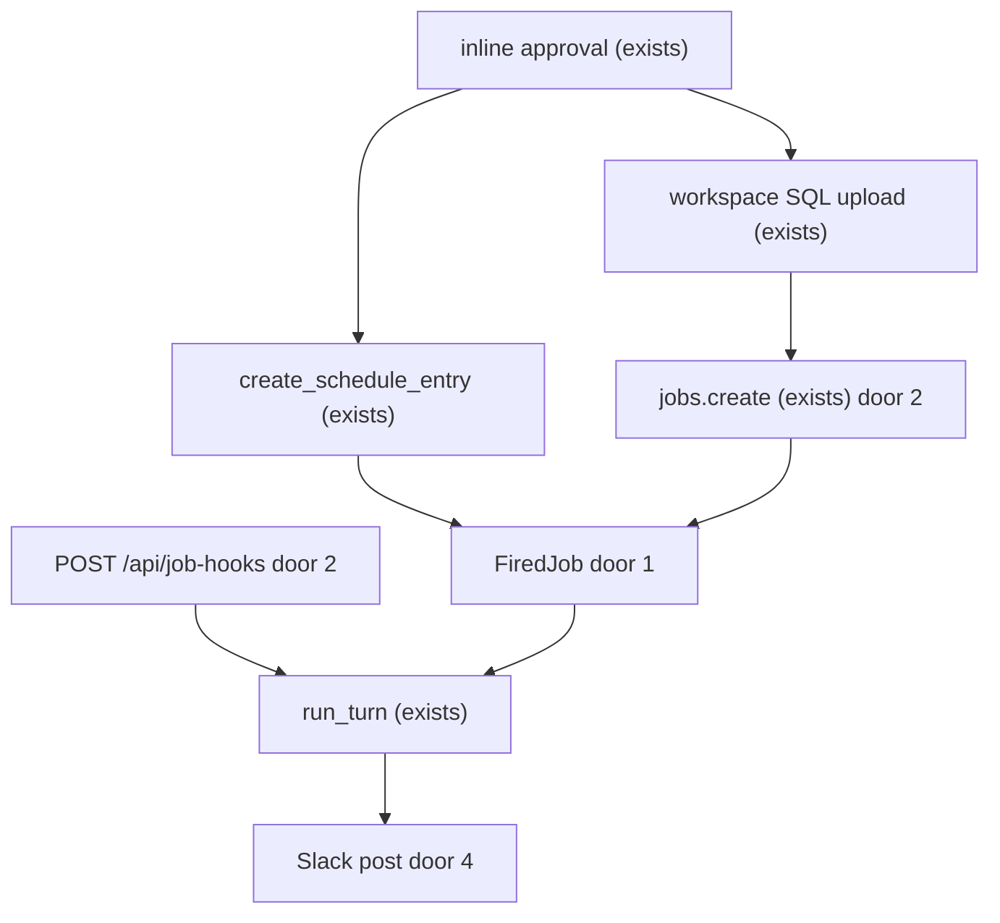
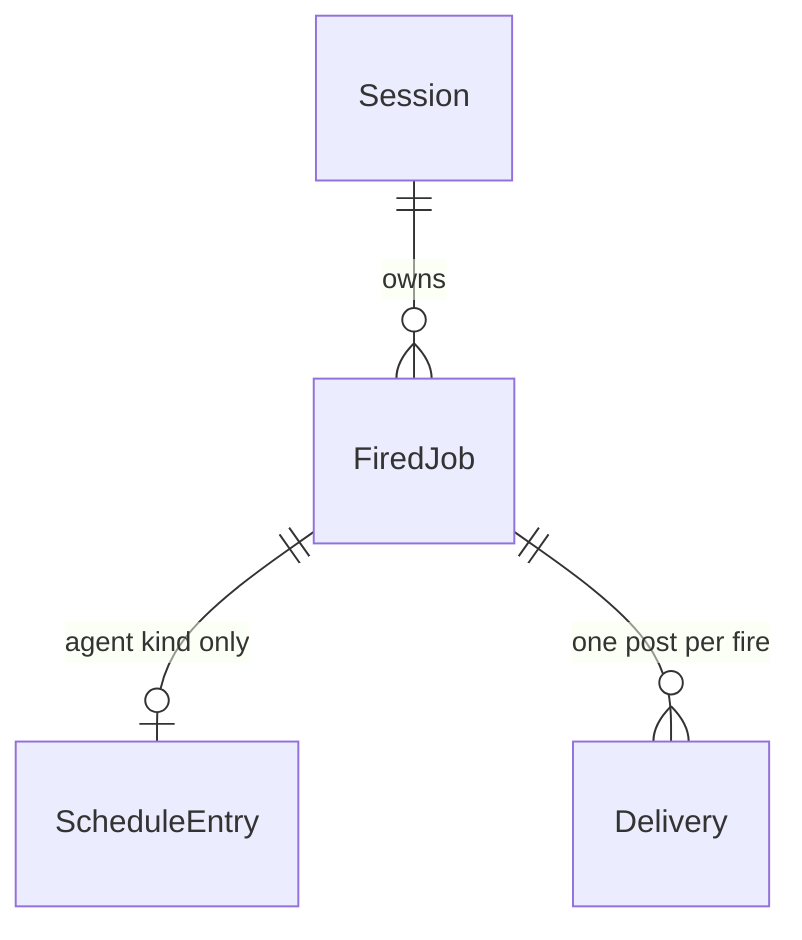

# Fired jobs

## Problem

A person who wants a recurring analysis has two clocks that do not meet. A Lakeflow job created from chat can run SQL on a Quartz schedule, and the only "agent" that job can carry is one warehouse `ai_query` over a sample of rows: no skills, no SQL tools, no Slack post, no spreadsheet. An in-app `/schedule` can run a full Clawhouse turn back into the chat session, and that turn is not a Databricks job. Slack and Google Sheets are separate chat tools that pause for an approval nobody can click when the run is unattended. The source gives no volume or date, only the request: schedule it from chat, let the fired work be SQL, SQL into a Clawhouse agent, or an agent run with instructions, and post the result to Slack and a spreadsheet.

When this ships, chat can schedule one of those three kinds. A fired SQL or SQL-into-agent job is a Lakeflow job. An agent-only run is an app schedule. On success, Slack receives either the SQL rows or the Clawhouse agent's reply. A spreadsheet is written on that same run only when the run still holds a user token.

## Flow

This reuses `JobsIdentity`, workspace SQL upload, `build_cron_schedule`, `run_turn`, `create_schedule_entry`, and the sheets writer. It does not call `build_agentic_query`.

1. Chat calls `jobs_schedule` -> inline approval (exists) pauses the turn before any Databricks or Lakebase write.
2. Approved `kind=sql` or `kind=sql_agent` -> workspace SQL upload (exists) writes the user's SQL unchanged -> `jobs.create` (exists) attaches the Quartz schedule and door 2 -> persists `FiredJob` (door 1).
3. Approved `kind=agent` -> `find_agent` (exists) resolves the name -> `create_schedule_entry` (exists) stores the instructions as the schedule prompt -> persists `FiredJob` (door 1) with no Databricks job.
4. Databricks `jobs.on_success` or `jobs.on_failure` -> `POST /api/job-hooks` (door 2) loads the `FiredJob` and the run output via `jobs_get_run_output` (exists).
5. `kind=sql` posts rows. `kind=sql_agent` calls `run_turn` (exists) headless with the named agent, then posts that reply. `jobs.on_failure` posts the failure and does not call `run_turn`.
6. A due agent schedule -> `schedule_worker` (exists) calls `run_turn` (exists) headless, then the Slack post (door 4).
7. out: one Slack message, and a spreadsheet only when that run's user token is non-empty. `claw/agents/main/skills/lakeflow-jobs/SKILL.md` (exists) is the instruction the chat model reads before it calls `jobs_schedule`.

## Impact

| Front | What changes |
| --- | --- |
| domain | new term: `FiredJob` - one scheduled outcome whose kind is `sql`, `sql_agent`, or `agent` |
| domain | new term: `Delivery` - one Slack attempt for one fire, used as the duplicate lock |
| domain | existing term: agentic job still means `build_agentic_query` / `ai_query` inside `jobs_create` when `agent_name` is set. Who branches today: `_resolve_sql_text` in `jobs_tasks.py`. A fired job does not enter that function |
| stored data | new `FiredJob` and `Delivery` rows. Nothing to backfill. Existing `clawhouse.schedules` rows stay chat-only |

## Relations

One-way constraints: `FiredJob` kind is `sql`, `sql_agent`, or `agent` (door 1). A `sql` or `sql_agent` row has one Databricks job id and no schedule. An `agent` row has one schedule and no Databricks job id. `Delivery` is unique per Databricks job id + run id + event type, and per schedule id + scheduled slot (door 4).

## Surface

| Route | In | Out | Status |
| --- | --- | --- | --- |
| `POST /api/job-hooks` | Basic username `clawhouse`, password `CLAWHOUSE_JOB_HOOK_PASSWORD`, JSON `event_type`, `job.job_id`, `run.run_id` | `delivered` or `duplicate` or `error` | 200, 401, 404, 502 |

## Landing

| One-way door | Literal shape | Alternative rejected |
| --- | --- | --- |
| FiredJob kind (door 1) | kind `sql` \| `sql_agent` \| `agent`. `sql` and `sql_agent` store a Databricks job id. `agent` stores a schedule id and no Databricks job id | A Lakeflow task of `SELECT 1` for agent-only runs. A job requires a task, and that task spends a SQL warehouse run to carry no SQL |
| Wake-up (door 2) | `WebhookNotifications(on_success=[Webhook(id)], on_failure=[Webhook(id)])` on one destination `display_name="clawhouse-job-hook"`, `GenericWebhookConfig(url=<{app}/api/job-hooks>, username="clawhouse", password=CLAWHOUSE_JOB_HOOK_PASSWORD)`. Handler reads `event_type`, `job.job_id`, `run.run_id` | `schedule_worker` polling Databricks. Two clocks, and the agent can start before the SQL task has finished |
| Analysis engine (door 3) | `run_turn` on the named Clawhouse agent. The workspace SQL file is the user's SQL and does not contain `ai_query` | `build_agentic_query`. One model call over 100 sampled rows, no skills, no tool loop |
| Slack exactly-once attempt (door 4) | Insert `Delivery` before the Slack POST. Unique conflict returns 200 and does not post. Slack status outside 2xx deletes that row and the hook returns 502 | Post first, insert after. A crash after Slack accepts sends a second message on the retry |

- Nothing else in this change is hard to reverse

## Criteria

### S1: Schedule one of the three kinds from chat (P1)

Chat creates a raw-SQL job, a SQL-into-agent job, or an agent run, after one approval.

**Acceptance Criteria**

1. WHEN a turn calls `jobs_schedule` THEN the system SHALL pause for approval before any workspace upload, `jobs.create`, or `create_schedule`.
2. WHEN `jobs_schedule` is approved with `kind="sql"` or `kind="sql_agent"`, a non-empty `query`, a `cron_expression`, and a `slack_webhook_url` that starts with `https://` THEN the system SHALL upload that query as a workspace SQL file that does not contain `ai_query` and SHALL create one Lakeflow job with that file, a Quartz schedule, and `webhook_notifications` `on_success` and `on_failure`.
3. WHEN the cron expression is `0 12 * * *` and `timezone_id` is omitted THEN the system SHALL send Quartz `0 0 12 * * ?` and timezone `UTC` with pause status `UNPAUSED`.
4. WHEN `jobs_schedule` is approved with `kind="sql_agent"` and `agent_name` THEN the system SHALL store that agent name on the `FiredJob` and SHALL NOT call `build_agentic_query`.
5. WHEN `jobs_schedule` is approved with `kind="agent"`, a known `agent_name`, and non-empty `instructions` THEN the system SHALL create one app schedule whose prompt equals those instructions and SHALL NOT call `jobs.create`.
6. WHEN `CLAWHOUSE_JOBS_SP_CLIENT_ID` and `CLAWHOUSE_JOBS_SP_CLIENT_SECRET` are set THEN `jobs_schedule` for `sql` and `sql_agent` SHALL create the Lakeflow job with `JobsIdentity` kind `service_principal`.
7. IF `kind` is not `sql`, `sql_agent`, or `agent`, OR `query` is empty for `sql` or `sql_agent`, OR `agent_name` is empty for `sql_agent` or `agent`, OR `instructions` is empty for `agent`, OR `slack_webhook_url` does not start with `https://`, OR `find_agent` returns no agent THEN the system SHALL return an `error` and SHALL NOT call `jobs.create` or `create_schedule`.
8. IF the user denies the approval THEN the system SHALL NOT call `jobs.create` or `create_schedule`.
9. IF the workspace SQL upload succeeds and `jobs.create` fails THEN the system SHALL return an `error`, SHALL NOT insert a `FiredJob`, and SHALL leave the workspace SQL file in place.
10. IF creating or listing the notification destination `clawhouse-job-hook` is permission-denied THEN the system SHALL return error `notification destination forbidden` and SHALL NOT call `jobs.create`.
11. The `lakeflow-jobs` skill SHALL name kinds `sql`, `sql_agent`, and `agent` and SHALL state that those kinds do not use `ai_query`.
12. The system SHALL include `jobs_schedule` in `DEFAULT_APPROVAL_REQUIRED_TOOLS`.

**Independent test:** Approve one call of each kind against a fake workspace client and assert the SQL file text, the job webhook ids, the schedule prompt, and that a denied call performs no write.

### S2: A fired SQL job posts rows to Slack (P1)

Databricks calls the hook after the SQL task. Slack gets a bounded preview. A repeat does not send a second message.

**Acceptance Criteria**

13. WHEN `POST /api/job-hooks` receives `event_type` `jobs.on_success` for a `kind="sql"` `FiredJob` with Basic username `clawhouse` and the configured password THEN the system SHALL return HTTP 200 with `delivered` true and SHALL post one Slack message containing that `job_id`, that `run_id`, and at most 20 rows from `sql_output`.
14. IF that same `job_id`, `run_id`, and `event_type` arrive again THEN the system SHALL return HTTP 200 with `duplicate` true and SHALL NOT post a second Slack message.
15. IF the Basic username is not `clawhouse` OR the password does not equal `CLAWHOUSE_JOB_HOOK_PASSWORD` OR that password is empty THEN the system SHALL return HTTP 401 with `error` `unauthorized` and SHALL NOT post to Slack.
16. IF `job.job_id` matches no `FiredJob` THEN the system SHALL return HTTP 404 with `error` `unknown job`.
17. WHEN `event_type` is `jobs.on_failure` THEN the system SHALL post one Slack message containing `jobs.on_failure`, the job id, and the run id, and SHALL NOT call `run_turn`.
18. WHEN `event_type` is `jobs.on_start` THEN the system SHALL return HTTP 200 and SHALL NOT post to Slack and SHALL NOT call `run_turn`.
19. IF the Slack POST status is outside 200-299 THEN the system SHALL delete the `Delivery` row and return HTTP 502 with `delivered` false.
20. IF a `Delivery` row already exists for that fire and the process did not reach Slack THEN a retry SHALL return HTTP 200 with `duplicate` true and SHALL NOT post.
21. The hook log line SHALL include `job_id` and `run_id` and SHALL NOT include `CLAWHOUSE_JOB_HOOK_PASSWORD` or the Slack webhook URL.

**Independent test:** Post the documented Databricks payload twice, once with a Slack endpoint that returns 500, and assert the status codes and the number of Slack calls.

### S3: SQL results enter a Clawhouse agent (P1)

The agent is `run_turn`, not `ai_query`. Slack gets the reply.

**Acceptance Criteria**

22. WHEN `jobs.on_success` arrives for `kind="sql_agent"` THEN the system SHALL call `run_turn` once with `headless` true, the stored agent, and a user message that contains at most 100 rows of `sql_output`.
23. WHEN that fired job's instructions are empty THEN the user message SHALL contain the sentence `Analyze these query results.`
24. WHEN `run_turn` returns a reply THEN the Slack message SHALL be that reply cut at 3000 characters.
25. WHILE the fired turn is headless, IF the model calls a tool in `DEFAULT_APPROVAL_REQUIRED_TOOLS` THEN the system SHALL deny it with `headless fired job: tool not approved` and SHALL NOT insert a pending approval.
26. IF the fired run's user token is empty THEN the system SHALL NOT call the Google Sheets writer, SHALL still post Slack, and SHALL record `sheet_status` `skipped`.
27. WHERE the fired run's user token is non-empty THEN the system SHALL write at most 500 rows and 26 columns and SHALL include the `https://docs.google.com/spreadsheets/d/` URL in the Slack message.

**Independent test:** Deliver one success payload for a `sql_agent` job and assert a single headless `run_turn`, no `ai_query` in the SQL file, and `sheet_status` `skipped` when the token is empty.

### S4: An agent run with instructions (P1)

No Databricks task. The existing worker runs the turn and Slack gets the reply.

**Acceptance Criteria**

28. WHEN an app schedule linked to a `kind="agent"` `FiredJob` is due THEN the system SHALL call `run_turn` once with `headless` true and a user message equal to the stored instructions, then post that reply to Slack cut at 3000 characters.
29. IF a `Delivery` row already exists for that schedule id and that `next_run_at` THEN the worker SHALL NOT post a second Slack message.

**Independent test:** Advance one due agent schedule with a fake clock and assert one headless turn and one Slack post.

## Out of scope

| Excluded | Why |
| --- | --- |
| Removing `task_type="agentic"` and `build_agentic_query` | Existing chat jobs keep the warehouse `ai_query` path. Fired jobs do not enter it |
| Writing SQL results to a Unity Catalog table | "Somewhere" in this slice is Slack, and a spreadsheet when a user token is present |
| Persisting a user OBO token for later fires | Conflicts with fail-closed identity. Recorded as a go-live question, not a store |
| Cascade-delete of the Lakeflow job when a `FiredJob` row is removed | `jobs_delete` already exists for an explicit delete |
| Email, Teams, and PagerDuty destinations | The wake-up destination is one generic webhook |
| Editing a fired job's query or instructions after create | `jobs_edit` stays on the old job tools |

## Assumptions

No leftover assumptions. Each default is a numbered criterion or a Landing row.

**Open questions:**

| # | Kind | Question | Until answered |
| --- | --- | --- | --- |
| 1 | blocks go-live | A fired run has no forwarded user token, so Google Sheets and `dbsql_query` fail closed (ADR-0009, `docs/integrations/google-sheets-mcp.md`). How should an unattended run write a spreadsheet and issue new SQL? | Real schedules post to Slack and record `sheet_status` `skipped`. The agent analyzes the fetched SQL payload. It does not gain a warehouse token |
| 2 | blocks go-live | Databricks requires an administrator to configure notification destinations. The jobs identity may not be allowed to create `clawhouse-job-hook` | `sql` and `sql_agent` return `notification destination forbidden` and create no job. `kind=agent` does not need the destination |

## Observable

| Surface | Decision | Landing |
| --- | --- | --- |
| tool `jobs_schedule` | flags and defaults | AC 2, AC 3, AC 5, AC 7 |
| tool `jobs_schedule` | output on success | AC 2, AC 5 |
| tool `jobs_schedule` | failure halfway | AC 9, AC 10 |
| tool `jobs_schedule` | destructive confirm | existing - inline approval before the tool body runs |
| API `POST /api/job-hooks` | response shape | AC 13, AC 14 |
| API `POST /api/job-hooks` | error shape and codes | AC 15, AC 16, AC 19 |
| API `POST /api/job-hooks` | who may call | AC 15 |
| API `POST /api/job-hooks` | versioning, rate limits | n/a - one Databricks caller, one unversioned payload from the jobs notification docs |
| skill `lakeflow-jobs` | what the reader does next | AC 11 |
| Slack message | structure and next step | AC 13, AC 17, AC 24 |
| spreadsheet | row bound, duplicates | AC 26, AC 27 |
| screen Jobs | empty, error, unauthorised | n/a - no new screen; Databricks jobs and app schedules already list there |

## Sources

- User request, 2026-10-19 - three fired kinds, Clawhouse agent, Slack and spreadsheet. No metric attached
- Databricks jobs notifications, HTTP webhook payloads - `event_type`, `job.job_id`, `run.run_id`; an administrator configures destinations
- `databricks.sdk` `JobsAPI.create` accepts `webhook_notifications`; `GenericWebhookConfig` has `url`, `username`, `password`
