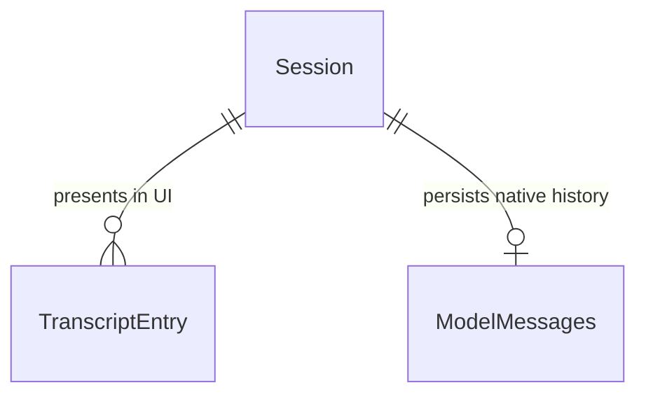

# Plan: Persist Native ModelMessages and Simplify Approval Resume

## Problem

Today, session message history is reconstructed on every turn and resume from flat `TranscriptEntry` rows in `src/clawhouse/agent/history.py`. This has three structural flaws:
1. Reconstruction drops unpaired tool calls, losing state during tool execution pauses.
2. In `src/clawhouse/agent/turn.py`, resuming from approval manually recreates `ToolCallPart`, re-substitutes `[REDACTED]` with the active token, and requires `skip_tool_call_id`.
3. In `src/clawhouse/capabilities/mentions.py`, `_transcript_to_messages` maintains a second divergent conversion that discards tool calls entirely.

When this ships, the session store persists native Pydantic AI `ModelMessage` payloads directly via `ModelMessagesTypeAdapter` per session. Resuming approval runs natively through `agent.run(None, message_history=..., deferred_tool_results=...)` without string replacements, manual part reconstruction, or hacky tool call re-injections. For existing sessions without native stored messages, the system automatically falls back to transcript reconstruction.

## Flow

1. Model turn completes or pauses on tool approval yielding result (exists)
2. Turn runner persists native messages payload via session store
3. Subsequent turns and approval resumes fetch native messages from session store
4. If native messages are present -> deserialized via `ModelMessagesTypeAdapter.validate_json` (exists)
5. If native messages are absent -> falls back to transcript reconstruction via `to_model_messages` (exists)
6. Resume passes native history directly to agent run without string redaction replacements

## Impact

| Front | What changes |
| --- | --- |
| domain | protocol: `SessionStore` adds `messages(session_id)` and `save_messages(session_id, messages)` |
| domain | existing class: `MemorySessionStore` implements `messages` and `save_messages`, clears messages on `clear_transcript` |
| domain | existing class: `LakebaseSessionStore` implements `messages` and `save_messages` against `clawhouse.sessions`, clears messages on `clear_transcript` |
| domain | existing module: `clawhouse.agent.turn` loads native messages on turn and resume, removes `[REDACTED]` substitution and manual `ToolCallPart` recreation |
| domain | existing module: `clawhouse.capabilities.mentions` removes `_transcript_to_messages` in favor of shared history loading |
| stored data | column: `messages text` on `clawhouse.sessions` storing serialized native model messages |

## Relations

One-way constraints: Stored `messages` represents the authoritative LLM context for the session. `TranscriptEntry` rows remain the UI presentation view and fallback.

## Surface

None - internal session store and turn execution persistence only

## Landing

| Door | Why | What makes it two-way |
| --- | --- | --- |
| `clawhouse.sessions.messages text` column | Stores serialized JSON bytes of native model messages | Nullable column; fallback to `transcript_entries` remains active |

## Criteria

Grouped by slice - one observable outcome each, never a layer. Numbering runs across the whole plan.

### S1: Native ModelMessages Storage and Turn Resume (P1)

Persist native Pydantic AI messages per session, eliminate string replacement in resume, and support transcript fallback for legacy sessions.

**Acceptance Criteria**

1. The system SHALL store native model messages on `MemorySessionStore` and `LakebaseSessionStore` via `save_messages` and retrieve them via `messages`.
2. WHEN a chat turn completes or pauses for approval THEN the system SHALL persist the native `ModelMessage` history to the store.
3. WHEN a paused turn is resumed with approval or denial THEN the system SHALL execute `agent.run` with the persisted native history and deferred tool results WITHOUT modifying or replacing `[REDACTED]` strings in arguments.
4. WHEN a session does not have stored native messages THEN the system SHALL reconstruct message history from transcript entries via `to_model_messages`.
5. WHEN `clear_transcript` is called on a session THEN the system SHALL clear both transcript entries and stored native messages.
6. The system SHALL NOT maintain a duplicate `_transcript_to_messages` function in `clawhouse.capabilities.mentions`.

**Independent test:** Run turn that pauses for approval; verify `store.messages(session_id)` is non-empty; resume approval and verify successful completion without string substitution; test legacy session without stored messages successfully executes turn via fallback.

## Out of scope

Product capabilities only. Process and harness rules live in AGENTS.md or as Observable `n/a`.

| Excluded | Why |
| --- | --- |
| Changing REST APIs or SSE event schemas | Turn output contracts and UI streaming contracts remain unchanged |
| Modifying approval status lifecycle in storage | Approval table schema and transitions remain unchanged |

## Assumptions

Defaults that are not already a numbered criterion. Drop a row once it is.

| Assumption | Chosen default | Rationale | Confirmed? |
| --- | --- | --- | --- |
| Serialization format | UTF-8 JSON bytes via `result.all_messages_json()` / `ModelMessagesTypeAdapter` | Standard first-party Pydantic AI serialization | y |

**Open questions:** none - all resolved or logged above.

## Observable

Worksheet, not the review. `n/a` needs its reason. One row may group the same decision across several routes.

| Surface | Decision | Landing |
| --- | --- | --- |
| CLI / Env | environment variable parsing | n/a - no new environment variables |
| all new `/api/*` routes | versioning, rate limits | n/a - no new HTTP routes added |

## Sources

- GitHub Issue #79 - `[2/14] Persistir ModelMessages nativos e simplificar resume de aprovação`
- GitHub Issue #77 - `Epic: simplificar e usar pydantic-ai de forma nativa`
