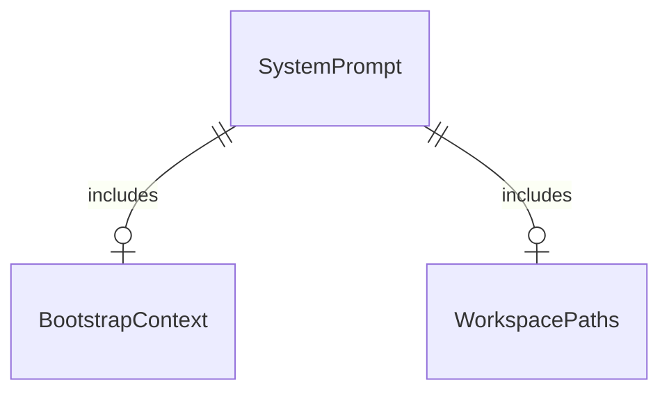

# Plan: Remove Manual ToolCards from System Prompt

## Problem

Today, `clawhouse.agent.turn` and `clawhouse.capabilities.sheets` maintain parallel static catalogues of tool descriptions and names (`DATABRICKS_TOOL_CARDS`, `GOOGLE_SHEETS_TOOL_CARDS`, `SAVE_PROFILE_TOOL_CARD`, `CREATE_AGENT_TOOL_CARD`) that are stitched together in `_prompt_for` and rendered into a `# Tools` markdown section in the system prompt.

Because Pydantic AI natively generates and sends JSON tool specifications (names, docstring descriptions, parameter schemas, and type annotations) to the LLM via standard API function-calling mechanisms, injecting duplicate text catalogues into the system prompt doubles token consumption for tools, clutters prompt context, and inevitably causes drift between prompt text (e.g. `(needs approval)` in card descriptions) and actual runtime approval gates or tool signatures.

When this ships, all manual static tool card definitions in `turn.py` and `sheets.py` will be eliminated. `build_system_prompt` will no longer require a mandatory list of `ToolCard`s and will omit `# Tools` when none are provided. `_prompt_for` will generate lean system prompts relying entirely on Pydantic AI's native tool definition delivery.

## Flow

1. Turn request enters -> `clawhouse.agent.turn` (exists) prepares turn context
2. `clawhouse.agent.turn` (exists) generates system prompt via `build_system_prompt` without manual tool cards
3. `pydantic_ai.Agent` (exists) provides capabilities and receives native tool definitions from toolsets
4. out: Model selects and executes tools directly via native schemas with zero prompt catalog duplication

## Impact

| Front | What changes |
| --- | --- |
| domain | existing function: `build_system_prompt` in `clawhouse.agent.prompt` makes `tools` optional (default None) and omits `# Tools` section when tools are not provided |
| domain | existing module: `clawhouse.agent.turn` removes `DATABRICKS_TOOL_CARDS`, `SAVE_PROFILE_TOOL_CARD`, `CREATE_AGENT_TOOL_CARD`, and card concatenation in `_prompt_for` |
| domain | existing module: `clawhouse.capabilities.sheets` removes `GOOGLE_SHEETS_TOOL_CARDS` |
| stored data | None - in-memory prompt composition only |

## Relations

One-way constraints: System prompt never includes manual hardcoded tool card lists. No columns and no types here.

## Surface

None - internal system prompt generation refactor only

## Landing

None - purely internal prompt cleanup; no one-way architectural doors

## Criteria

Grouped by slice - one observable outcome each, never a layer. Numbering runs across the whole plan.

### S1: Remove Manual Tool Cards and Redundant System Prompt Tools (P1)

Eliminate manual `ToolCard` catalogues from `turn.py` and `sheets.py`, make `tools` optional in `build_system_prompt`, and rely on native Pydantic AI tool definitions.

**Acceptance Criteria**

1. The system SHALL allow `build_system_prompt` to be called without passing `tools`, omitting the `# Tools` section from the resulting prompt.
2. WHEN `tools` is not passed or is empty in `build_system_prompt` THEN the system SHALL NOT raise `ValueError`.
3. The system SHALL NOT maintain manual tool card constants `DATABRICKS_TOOL_CARDS`, `GOOGLE_SHEETS_TOOL_CARDS`, `SAVE_PROFILE_TOOL_CARD`, or `CREATE_AGENT_TOOL_CARD`.
4. WHEN `_prompt_for` builds the system prompt for a turn THEN the system SHALL NOT inject manual tool cards into `build_system_prompt`.
5. WHEN evaluations in `evals.py` or agent turns run with capabilities THEN the system SHALL preserve valid tool calling without regression.

**Independent test:** Call `build_system_prompt(runtime=RuntimeMeta(session_id="..."))` and assert `# Tools` is absent and no exception is raised; assert `DATABRICKS_TOOL_CARDS` and `GOOGLE_SHEETS_TOOL_CARDS` cannot be imported; run `uv run pytest tests/test_prompt.py tests/test_evals.py tests/test_turn.py` with 0 failures.

## Out of scope

Product capabilities only. Process and harness rules live in AGENTS.md or as Observable `n/a`.

| Excluded | Why |
| --- | --- |
| Removing `ToolCard` class definition completely | Retained as an optional backward-compatible dataclass in `clawhouse.agent.prompt` for callers explicitly providing custom cards |
| Modifying tool parameter schemas or docstrings | Capabilities already provide native docstrings and Pydantic parameter schemas |

## Assumptions

Defaults that are not already a numbered criterion. Drop a row once it is.

| Assumption | Chosen default | Rationale | Confirmed? |
| --- | --- | --- | --- |
| Optional backward compatibility for `tools` in `build_system_prompt` | If non-empty `tools` is explicitly provided, render `# Tools` | Keeps existing tests that explicitly test tool card formatting working if needed | y |

**Open questions:** none - all resolved or logged above.

## Observable

Worksheet, not the review. `n/a` needs its reason. One row may group the same decision across several routes.

| Surface | Decision | Landing |
| --- | --- | --- |
| CLI / Env | environment variable parsing | n/a - no new environment variables |
| all new `/api/*` routes | versioning, rate limits | n/a - no new HTTP routes added |

## Sources

- GitHub Issue #81 - `[4/14] Remover catálogo manual de ToolCards do prompt`
- GitHub Issue #77 - `Epic: simplificar e usar pydantic-ai de forma nativa`
