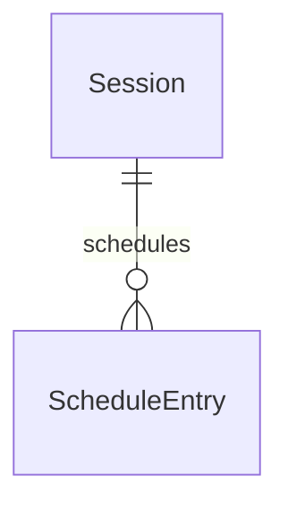

# Scheduled Turns: Production Credentials and Robust Advance

## Problem

Today, scheduled turns and Lakeflow job execution suffer from two critical fragility patterns in production:

1. **Unintended identity and silent ambient fallback for Lakeflow jobs**: In `DatabricksTools` and `default_workspace_client`, if the user token lacks job creation permissions or fails, the runtime silently falls back to the ambient Databricks App Service Principal (`WorkspaceClient()`). This creates jobs with the wrong owner/identity without notifying the user in chat. Furthermore, there is no configuration mechanism for a dedicated jobs service principal (`CLAWHOUSE_JOBS_SP_CLIENT_ID` / `CLAWHOUSE_JOBS_SP_CLIENT_SECRET`) to run unattended background jobs. When neither a dedicated SP nor a user OBO token is available, mutating job operations silently attempt ambient execution rather than reporting an explicit error. Finally, tool execution results from `jobs_create`, `jobs_edit`, `jobs_run_now`, and `jobs_cancel_run` omit identity metadata (`kind` and `label`), hiding the active execution identity from operators.
2. **Infinite retry loop on failing in-app scheduled turns**: In `schedule_worker` and `run_scheduled_turn`, `claim_due_schedules` performs a non-atomic `SELECT` where `status = 'active' AND next_run_at <= now`. If `run_turn_fn` fails before completion (e.g. `RunInProgress`, `SessionForbidden`, store errors), `store.update_schedule_run` is never reached. Consequently, `next_run_at` remains in the past, causing `schedule_worker` to re-claim the failing schedule every 15 seconds without exponential backoff or timestamp advance. In Lakebase, concurrent worker replicas also lack atomic row claiming (`FOR UPDATE SKIP LOCKED`), risking duplicate turn execution.

When this ships, Lakeflow job operations will strictly follow explicit identity precedence (dedicated SP -> user OBO -> explicit error, with zero silent ambient fallback), reporting the acting identity in tool results and chat transcripts. Concurrently, in-app schedule polling will atomically claim due schedules and reliably advance `next_run_at` or record errors even when turn execution raises exceptions.

## Flow

This feature reuses existing `DatabricksTools` (`src/clawhouse/capabilities/databricks.py`), `LakebaseSessionStore` (`src/clawhouse/store/store.py`), `schedule_worker` (`src/clawhouse/capabilities/schedules.py`), and `calculate_next_run`.

1. Mutating tool call or scheduled turn trigger enters -> `clawhouse.capabilities.databricks` (exists) resolves execution identity via `JobsIdentity` (door 1) using `clawhouse.settings` (exists)
2. `clawhouse.capabilities.databricks` (exists) executes Lakeflow job operations using explicit `JobsIdentity` and returns result payload enriched with `identity: {"kind": ..., "label": ...}`
3. `clawhouse.capabilities.schedules` (exists) `schedule_worker` polls due schedules and invokes `clawhouse.store.store` (exists) with atomic row claim (door 2)
4. out: `TurnResult` to chat session or transcript with `identity` metadata, and `clawhouse.capabilities.schedules` (exists) advances `next_run_at` in `clawhouse.store.store` (exists) even on turn execution failure

## Impact

| Front | What changes |
| --- | --- |
| domain | new term: `JobsIdentity` - frozen dataclass with `kind: Literal["service_principal", "user_obo"]`, `client: WorkspaceClient`, and `label: str`, lives in `clawhouse.capabilities.databricks` |
| domain | new term: `MissingJobsIdentityError` - exception raised when neither dedicated SP nor user OBO token is configured, lives in `clawhouse.capabilities.databricks` |
| domain | existing config: `Settings` adds `jobs_sp_client_id: str \| None` and `jobs_sp_client_secret: str \| None` parsed from `CLAWHOUSE_JOBS_SP_CLIENT_ID` and `CLAWHOUSE_JOBS_SP_CLIENT_SECRET` |
| stored data | `clawhouse.schedules` in Lakebase adds nullable columns `last_status` and `last_error` via additive idempotent migration in `store.py:migrate`; existing active schedules remain untouched |

## Relations

One-way constraints: `clawhouse.schedules` status enum includes active and cancelled states; new nullable tracking fields `last_status` and `last_error`. No columns and no types here.

## Surface

None - nothing consumed outside

## Landing

| One-way door | Literal shape | Alternative rejected |
| --- | --- | --- |
| Jobs execution identity precedence (door 1) | `JobsIdentity(kind: Literal["service_principal", "user_obo"], client: WorkspaceClient, label: str)` with precedence: 1. SP `oauth-m2m` if `jobs_sp_client_id` set, 2. user `pat` if `user_token` set, 3. raise `MissingJobsIdentityError` | Silent fallback to ambient app SP; rejected because it masks permission misconfigurations, assigns unintended ownership to Databricks App resource principal, and violates auditability |
| In-app schedule atomic claim and guaranteed advance (door 2) | SQL: `SELECT ... FROM clawhouse.schedules WHERE status = 'active' AND next_run_at <= $1 FOR UPDATE SKIP LOCKED` plus advancing `next_run_at` in `finally` block on turn exception | Removing `/schedule` entirely; rejected because in-app scheduled turns stream recurring alerts and digests directly back into chat sessions without spinning up external Databricks jobs |

- Nothing else in this change is hard to reverse

## Criteria

Grouped by slice - one observable outcome each, never a layer. Numbering runs across the whole plan.

### S1: Dedicated Service Principal & Jobs Identity Resolution (P1)

Configuration parsing for dedicated Jobs SP and strict identity resolution without silent ambient fallback.

**Acceptance Criteria**

1. The system SHALL populate `Settings.jobs_sp_client_id` and `Settings.jobs_sp_client_secret` from `CLAWHOUSE_JOBS_SP_CLIENT_ID` and `CLAWHOUSE_JOBS_SP_CLIENT_SECRET` in `settings_from_env`.
2. WHERE `jobs_sp_client_id` and `jobs_sp_client_secret` are set in settings THEN `jobs_identity` SHALL return `JobsIdentity` with `kind="service_principal"`, `label=settings.jobs_sp_client_id`, and a `WorkspaceClient` initialized with `auth_type="oauth-m2m"`.
3. WHERE `jobs_sp_client_id` is unset AND `user_token` is non-empty THEN `jobs_identity` SHALL return `JobsIdentity` with `kind="user_obo"`, `label="user"`, and a `WorkspaceClient` initialized with `token=user_token` and `auth_type="pat"`.
4. IF `jobs_sp_client_id` is unset AND `user_token` is empty or unset THEN `jobs_identity` SHALL raise `MissingJobsIdentityError` and SHALL NOT fall back to ambient application credentials.
5. WHEN `jobs_create`, `jobs_edit`, `jobs_run_now`, or `jobs_cancel_run` executes successfully THEN the system SHALL include an `identity` dictionary containing `kind` and `label` in the returned dictionary.
6. IF a mutating jobs tool fails because neither SP credentials nor a user token is available THEN the system SHALL return a dictionary with an `error` message explaining that no jobs execution identity is configured.

**Independent test:** Invoke `jobs_identity` under various combinations of SP settings and user token to assert returned `kind` and exception on empty inputs; call `jobs_create` and inspect returned dictionary for the `identity` key.

### S2: Robust Next Run Advance & Atomic Schedule Claiming (P1)

Lakebase concurrency protection and guaranteed timestamp advancing on failure in the in-app scheduler.

**Acceptance Criteria**

7. WHEN `LakebaseSessionStore.claim_due_schedules` executes THEN the system SHALL select due active schedules with `FOR UPDATE SKIP LOCKED` ordered by `next_run_at ASC`.
8. WHEN `run_scheduled_turn` completes a turn successfully THEN the system SHALL advance `next_run_at` to the next calculated cron interval and record `last_status="ok"`.
9. IF `run_scheduled_turn` encounters an exception during turn execution THEN the system SHALL advance `next_run_at` to the next calculated cron interval and record `last_status="error"` and `last_error` with the exception message.
10. IF `schedule_worker` processes a batch of due schedules and one schedule raises an unhandled error THEN the system SHALL continue processing remaining schedules in the batch without halting the worker loop.

**Independent test:** Seed a failing schedule in `store`, run one worker poll iteration, and assert `next_run_at` advances to a future timestamp while recording `last_status="error"`.

## Out of scope

Product capabilities only. Process and harness rules live in AGENTS.md or as Observable `n/a`.

| Excluded | Why |
| --- | --- |
| Temporal / DBOS durable execution engine | Out of scope for this slice; in-app scheduler uses Lakebase Postgres polling and croniter |
| Automatic credential rotation endpoint | Service Principal client secrets are managed externally via Databricks App resource secrets or workspace secret scopes |
| Multi-task job DAG orchestration | Lakeflow job tools target single-task analytical, python, and sql tasks |

## Assumptions

Defaults that are not already a numbered criterion. Drop a row once it is.

| Assumption | Chosen default | Rationale | Confirmed? |
| --- | --- | --- | --- |
| Read-only jobs tools ambient fallback | Read-only tools (`jobs_list`, `jobs_get_run`, `jobs_get_run_output`) retain ambient fallback if user token cannot read job | Safe visibility inspection does not mutate workspace resources | y |
| Error advance calculation on failing schedule | Advances to standard next cron interval via `calculate_next_run` rather than immediate retry | Prevents fast retry storms on persistent syntax or model errors | y |

**Open questions:** none - all resolved or logged above.

## Observable

Worksheet, not the review. `n/a` needs its reason. One row may group the same decision across several routes.

| Surface | Decision | Landing |
| --- | --- | --- |
| CLI / Env `CLAWHOUSE_JOBS_SP_CLIENT_ID` | SP client ID configuration | AC 1, AC 2 |
| CLI / Env `CLAWHOUSE_JOBS_SP_CLIENT_SECRET` | SP secret configuration | AC 1, AC 2 |
| Tool `jobs_create` | returns acting identity metadata | AC 5 |
| Tool `jobs_edit` | returns acting identity metadata | AC 5 |
| Tool `jobs_run_now` | returns acting identity metadata | AC 5 |
| Tool `jobs_cancel_run` | returns acting identity metadata | AC 5 |
| all new `/api/*` routes | versioning, rate limits | n/a - no new HTTP routes added |

## Sources

- GitHub Issue #78 - `[1/14] Turnos agendados: token de produção e avanço robusto de next_run_at`
- GitHub Issue #77 - `Epic: simplificar e usar pydantic-ai de forma nativa`
- `tests/test_jobs_create_characterization.py` - step 1 natural language characterization tests
