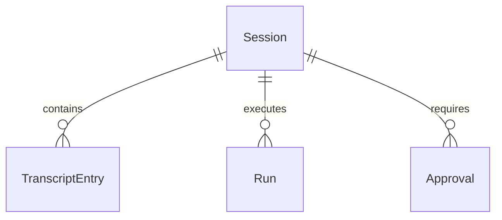

# Session Renaming and Better Management

## Problem

Today, Clawhouse sessions have no explicit user-defined title. A session's title in `SessionSummary.title` is derived on-the-fly from the text of the first user message in `clawhouse.transcript_entries`, falling back to an empty string ("Untitled session" in the UI). When a user initiates a session with a generic or exploratory query (such as "hello", "@databricks help", or a raw code snippet), the session retains that title permanently in the sidebar rail and on `/sessions`. Users cannot rename a session to reflect its true goal or current state.

Furthermore, the chat screen (`/chat`) lacks a dedicated header showing the current session title and controls. Users have no immediate visual context of which session they are in, nor an inline way to rename the session or reset its transcript. On the `/sessions` management page (`/sessions`), there is no search or filter input, no session count summary, no inline rename action, and no way to clear a session's transcript without deleting the session entirely. Finally, the backend has no endpoint to update session metadata (`PATCH /api/sessions/{session_id}`), and the Lakebase `clawhouse.sessions` table lacks a `title` column.

When this ships, users can view and edit session titles inline directly from the chat pane header, the sidebar rail, and the `/sessions` page. They can search and filter sessions on `/sessions`, reset/clear a session transcript without destroying the session, and have their custom titles persist across page reloads and devices.

## Flow

This feature reuses existing session ownership authorization, `SessionSummary` shapes, `store.clear_transcript`, and the frontend event bus.

1. User triggers a session rename in `frontend/chat.ts` (exists), `frontend/shell.ts` (exists), or `frontend/sessions.ts` (exists)
2. `clawhouse.api.app` (exists) - receives `PATCH /api/sessions/{session_id}`, validates session UUID, verifies caller ownership, and validates non-empty title
3. `clawhouse.store.store` (exists) - updates `clawhouse.sessions.title` in Lakebase or `_MemorySession.title` in MemorySessionStore (door 1 & door 2)
4. out: `SessionOut` (200), and `frontend/shell.ts` (exists) dispatches a `clawhouse:session-renamed` event to synchronize active rail items and headers without a full reload

## Impact

| Front | What changes |
| --- | --- |
| domain | existing term: `SessionSummary.title` previously meant first user message; now means custom title if set, falling back to first user message |
| domain | new event: `clawhouse:session-renamed` dispatched on `window` to keep shell rail, chat header, and sessions list synchronized |
| stored data | `clawhouse.sessions` table adds nullable column `title text`; existing rows remain unchanged and resolve via fallback logic |

## Relations

One-way constraints: none. No columns or types here.

## Surface

Only routes this adds or whose signature changes.

| Route | In | Out | Status |
| --- | --- | --- | --- |
| `PATCH /api/sessions/{session_id}` | `title` | `id`, `title`, `created_at`, `run_state` | `200`, `403`, `404`, `422` |
| `GET /api/sessions/{session_id}` | `session_id` | `id`, `title`, `created_at`, `run_state` | `200`, `403`, `404`, `422` |
| `POST /api/sessions/{session_id}/clear` | `session_id` | `cleared` | `200`, `403`, `404`, `422` |

## Landing

| One-way door | Literal shape | Alternative rejected |
| --- | --- | --- |
| Session title schema | `ALTER TABLE clawhouse.sessions ADD COLUMN IF NOT EXISTS title text;` | Separate key-value metadata table; rejected because session title is a primary relational attribute that should not require an extra join on every listing |
| Session rename API verb & payload | `PATCH /api/sessions/{session_id}` with `{"title": str}` | `PUT /api/sessions/{session_id}`; rejected because PUT semantics require replacing the entire session entity including read-only fields |
| Fallback resolution order | `s.title` if non-null and trimmed non-empty, else first user entry content, else `""` | Overwriting title automatically on every message; rejected because it destroys manual user renames |

- Nothing else in this change is hard to reverse

## Criteria

Grouped by slice - one observable outcome each, never a layer. Numbering runs across the whole plan.

### S1: Session Metadata & Renaming Backend API (P1)

Persistent title column in Lakebase and Memory session stores, plus rename, get, and clear endpoints.

**Acceptance Criteria**

1. WHEN a client sends a valid `PATCH /api/sessions/{session_id}` with `{"title": "New Title"}` THEN the system SHALL update the session title in the store and return HTTP 200 with the updated `SessionOut`.
2. IF a client sends `PATCH /api/sessions/{session_id}` with a blank or whitespace-only title THEN the system SHALL return HTTP 422 with an error detail indicating title cannot be empty.
3. IF a client sends `PATCH /api/sessions/{session_id}` for a session owned by another user THEN the system SHALL return HTTP 403 with status detail indicating forbidden access.
4. IF a client sends `PATCH /api/sessions/{session_id}` for a non-existent session UUID THEN the system SHALL return HTTP 404 with status detail indicating session not found.
5. WHEN a client sends `GET /api/sessions/{session_id}` for an existing owned session THEN the system SHALL return HTTP 200 with the `SessionOut` object including id, title, created_at, and run_state.
6. WHEN a client sends `POST /api/sessions/{session_id}/clear` for an owned session THEN the system SHALL delete all transcript entries for that session while preserving the session id, created_at, and title, returning HTTP 200 with `{"cleared": true}`.
7. The system SHALL return the custom `title` in `list_sessions` and `SessionSummary` when set, falling back to the first user turn content when `title` is null or empty.

**Independent test:** Issue `PATCH /api/sessions/{id}` with title "Project Alpha", verify `GET /api/sessions/{id}` and `GET /api/sessions` return "Project Alpha", and verify `POST /api/sessions/{id}/clear` leaves the session with 0 transcript entries.

### S2: Chat Pane Header with Inline Rename & Reset (P1)

Sticky chat pane header displaying current session title with inline editing and clear transcript action.

**Acceptance Criteria**

8. The chat screen SHALL render a chat header element `#chat-header` above `#log` displaying the active session title (or "Untitled session" when empty).
9. WHEN the user clicks the rename button or title in `#chat-header` THEN the chat header SHALL replace the title text with an inline input element `#chat-title-input` pre-populated with the current title.
10. WHEN the user submits `#chat-title-input` with Enter or clicks Save THEN the system SHALL send `PATCH /api/sessions/{session_id}` with the trimmed value, update `#chat-header` text, and dispatch a `clawhouse:session-renamed` event.
11. IF the user presses Escape while editing `#chat-title-input` THEN the chat header SHALL cancel editing and revert to the previous title without sending a network request.
12. WHEN the user clicks the "Clear transcript" button in `#chat-header` and confirms the prompt THEN the system SHALL send `POST /api/sessions/{session_id}/clear`, remove all transcript entries from `#log`, and display a notice entry indicating the transcript was cleared.

**Independent test:** Open `/chat?session=<id>`, click the edit pencil in `#chat-header`, type "Refactor Lakeflow", press Enter, and verify `#chat-header` and active rail row display "Refactor Lakeflow".

### S3: Sidebar Rail Inline Rename Action (P2)

Rename action on each rail session row with live synchronization.

**Acceptance Criteria**

13. The sidebar rail SHALL render a rename action button `.rail-session-rename` on each `.rail-session` row before the delete button.
14. WHEN the user clicks `.rail-session-rename` THEN the system SHALL prevent navigation, display an inline title input on that row, and save the new title on Enter via `PATCH /api/sessions/{session_id}`.
15. WHEN a `clawhouse:session-renamed` window event is received THEN the sidebar rail SHALL update the corresponding row's `.rail-session-title` and `data-title` attribute to match the new title.

**Independent test:** Click the rename button on a session in the sidebar rail, change its title to "Agent Evaluation", press Enter, and verify the title updates in the rail without navigating away or reloading.

### S4: Enhanced Sessions Management Screen (P2)

Search/filter toolbar, session counter, inline rename, and clear actions on `/sessions`.

**Acceptance Criteria**

16. The `/sessions` screen SHALL render a search input `#sessions-search` and a counter element `#sessions-count` indicating the total number of sessions.
17. WHILE the user types a search query into `#sessions-search` the `/sessions` screen SHALL filter visible session rows to those whose title or date matches the search query.
18. The `/sessions` screen SHALL render a rename button `.btn-rename-session` and a clear button `.btn-clear-session` alongside the delete button for each session row.
19. WHEN the user clicks `.btn-rename-session` on `/sessions` and enters a new title THEN the system SHALL issue `PATCH /api/sessions/{session_id}`, update the row title in-place, and dispatch `clawhouse:session-renamed`.
20. WHEN the user clicks `.btn-clear-session` on `/sessions` and confirms THEN the system SHALL send `POST /api/sessions/{session_id}/clear` and update the row state without removing the session from the list.

**Independent test:** Navigate to `/sessions`, type a query in `#sessions-search`, verify filtering, rename a session using `.btn-rename-session`, and verify the session title updates in-place.

## Out of scope

Product capabilities only. Process and harness rules live in AGENTS.md or as Observable `n/a`.

| Excluded | Why |
| --- | --- |
| Folder or nested grouping of sessions | Out of scope for lean v1; date grouping and search sufficiently handle navigation |
| Session tagging or custom color labels | Deferred to future categorization slice |
| Multi-user session sharing or ACL delegation | Databricks Apps ambient single-owner model applies; collaboration handled in future permissions epic |
| Automatic LLM-generated smart titling via background agent | Keep rename deterministic and user-driven; LLM auto-titling adds background latency and token spend |

## Assumptions

Defaults that are not already a numbered criterion. Drop a row once it is.

| Assumption | Chosen default | Rationale | Confirmed? |
| --- | --- | --- | --- |
| Maximum title character limit | 120 characters | Prevents layout overflow in rail and header while accommodating descriptive session names | n |
| Handling clear transcript on active streaming turn | Reject clear request with HTTP 409 if session run_state is running | Prevents race condition between active writer run and transcript deletion | n |

**Open questions:** none - all resolved or logged above.

## Observable

Worksheet, not the review. `n/a` needs its reason. One row may group the same decision across several routes.

| Surface | Decision | Landing |
| --- | --- | --- |
| screen `chat` | empty state | existing - empty transcript view with prompt hints |
| screen `chat` | loading state | existing - transcript loading indicator and poll loop |
| screen `chat` | error state | existing - notice banner on turn error |
| screen `chat` | destructive action confirms | AC 12 |
| screen `chat` | session header and inline rename | AC 8, AC 9, AC 10, AC 11 |
| screen `rail` | inline rename and synchronization | AC 13, AC 14, AC 15 |
| screen `sessions` | search and filter | AC 16, AC 17 |
| screen `sessions` | inline rename and clear actions | AC 18, AC 19, AC 20 |
| screen `sessions` | empty state | existing - "No sessions yet. Start one." |
| screen `sessions` | destructive action confirms | existing - browser confirm dialog before delete or clear |
| API `PATCH /api/sessions/{session_id}` | error shape and codes | AC 2, AC 3, AC 4 |
| API `GET /api/sessions/{session_id}` | error shape and codes | AC 5 |
| API `POST /api/sessions/{session_id}/clear` | error shape and codes | AC 6 |
| all new `/api/sessions/*` routes | versioning, rate limits | n/a - internal application endpoints running behind Databricks App authenticated proxy |

## Sources

- `docs/openclaw-DESIGN.md` - Section 3.3 Sessions protocol and Control UI RPC mapping
- `docs/openclaw-ui/SCREENSHOTS.md` - Section 02 Sidebar / session rail and Section 04 Sessions (Threads) page
