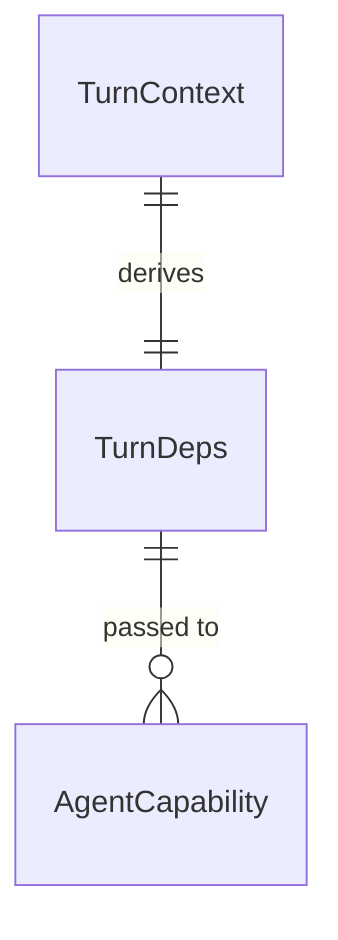

# Plan: Immutable Turn Capabilities and Token via Deps

## Problem

Today, `clawhouse.agent.turn._capabilities_for_turn` mutates capability instances in place:
`cap.user_token = claimed.ctx.user_token`. Because `TurnContext` and its capabilities can be shared or reused across concurrent turns or requests, in-place attribute assignment mutates shared runtime state. If two users or concurrent runs execute chat turns through the same shared capability, one user's token can overwrite the other's, creating a potential token leak or permission escalation between sessions. Additionally, `TurnDeps` currently only carries `now`, omitting the active turn's execution credentials from dependencies.

When this ships, `TurnDeps` will carry `user_token` as a frozen field, and `_capabilities_for_turn` will never mutate capability instances in place, instantiating or copying capability instances immutably per turn so concurrent turns with distinct user tokens execute in full isolation without shared state mutation.

## Flow

1. Turn request enters -> `clawhouse.agent.turn` (exists) builds frozen `TurnDeps(now=ctx.now, user_token=claimed.ctx.user_token)`
2. `clawhouse.agent.turn` (exists) resolves capabilities via `_capabilities_for_turn` without in-place mutation using `dataclasses.replace`
3. `pydantic_ai.Agent` (exists) runs the turn with isolated dependencies and capability copies
4. out: `TurnResult` returned to caller while original `TurnContext` capability instances retain their pristine state

## Impact

| Front | What changes |
| --- | --- |
| domain | existing term: `TurnDeps` adds `user_token: str = ""` as a frozen dataclass field in `clawhouse.agent.core` |
| domain | existing function: `_capabilities_for_turn` in `clawhouse.agent.turn` replaces in-place mutation with immutable capability copy via `dataclasses.replace` |
| stored data | None - runtime in-memory dependency and capability lifecycle only |

## Relations

One-way constraints: `TurnDeps` is frozen and slot-based; capability instances are never mutated during turn execution. No columns and no types here.

## Surface

None - internal turn dependency injection and capability resolution only

## Landing

None - purely internal immutable lifecycle refactor; no one-way architectural doors

## Criteria

Grouped by slice - one observable outcome each, never a layer. Numbering runs across the whole plan.

### S1: Immutable Capability Resolution & TurnDeps Token (P1)

Frozen `TurnDeps` credential passing and zero-mutation per-turn capability copies.

**Acceptance Criteria**

1. The system SHALL include `user_token: str = ""` as a frozen field in `TurnDeps`.
2. WHEN `run_turn`, `resume_turn`, or `_run_turn_impl` initializes `TurnDeps` THEN the system SHALL populate `TurnDeps.user_token` from `TurnContext.user_token`.
3. WHEN `_capabilities_for_turn` configures `databricks_capability` with a non-empty `TurnContext.user_token` THEN the system SHALL NOT mutate the original `TurnContext.databricks_capability` instance.
4. WHEN two concurrent turns execute with different `user_token` values using a shared `DatabricksCapability` in their context THEN each turn SHALL initialize its tools using its respective `user_token` without cross-contamination.

**Independent test:** Call `run_turn` with a pre-configured `DatabricksCapability(user_token="")` and assert the instance attribute remains `""` after turn execution; execute two concurrent turns with different tokens and assert mock client factory calls receive each turn's respective token.

## Out of scope

Product capabilities only. Process and harness rules live in AGENTS.md or as Observable `n/a`.

| Excluded | Why |
| --- | --- |
| Rewriting all 17 Databricks tools to take `RunContext[TurnDeps]` | Per-turn immutable capability copy via `dataclasses.replace` cleanly isolates execution state without breaking existing tool signatures |
| Mutating other external auth providers | `DatabricksCapability` was the only capability with runtime attribute mutation in turn execution |

## Assumptions

Defaults that are not already a numbered criterion. Drop a row once it is.

| Assumption | Chosen default | Rationale | Confirmed? |
| --- | --- | --- | --- |
| Empty user token handling | If `TurnContext.user_token` is empty, existing capability token is preserved | Preserves ambient or preset credentials if turn context provides no user token | y |

**Open questions:** none - all resolved or logged above.

## Observable

Worksheet, not the review. `n/a` needs its reason. One row may group the same decision across several routes.

| Surface | Decision | Landing |
| --- | --- | --- |
| CLI / Env | environment variable parsing | n/a - no new environment variables |
| all new `/api/*` routes | versioning, rate limits | n/a - no new HTTP routes added |

## Sources

- GitHub Issue #80 - `[3/14] Não mutar DatabricksCapability compartilhada; token via deps`
- GitHub Issue #77 - `Epic: simplificar e usar pydantic-ai de forma nativa`
