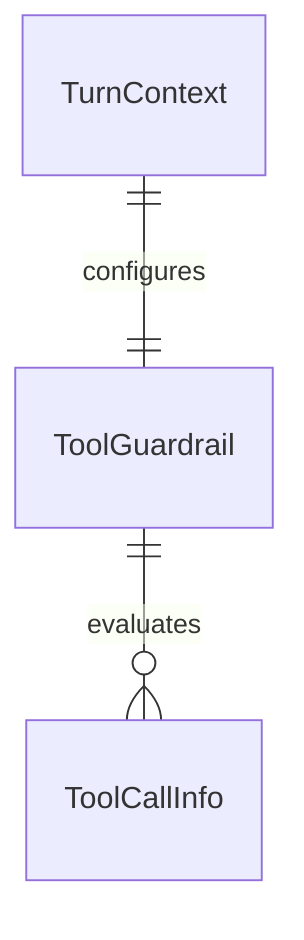

# Plan: Unify Approval Mechanisms into Single ToolGuardrail

## Problem

Today, tool approval requirements are fragmented across three separate mechanisms:
1. `DatabricksCapability.get_wrapper_toolset` wraps toolsets with `ApprovalRequiredToolset` checking `_APPROVAL_REQUIRED_TOOLS` and non-readonly `dbsql_query`.
2. `GoogleSheetsCapability.get_wrapper_toolset` wraps toolsets with `ApprovalRequiredToolset` checking `WRITE_TOOLS`.
3. `_sensitive_tool_guard` in `clawhouse.agent.turn` attaches a harness `ToolGuardrail` checking `claimed.ctx.sensitive_tools`.

This fragmentation scatters approval policies across capability modules, wraps toolsets multiple times with redundant wrapper layers, and obscures which tools require approval.

When this ships, a single unified `ToolGuardrail` in `clawhouse.agent.turn` will be the sole authority for all tool approval decisions (Lakeflow mutating operations, non-readonly SQL queries, Google Sheets writes, and configured sensitive tools). Both `DatabricksCapability` and `GoogleSheetsCapability` will drop their redundant `get_wrapper_toolset` and `ApprovalRequiredToolset` implementations.

## Flow

1. Model emits a tool call -> intercepted by `ToolGuardrail` in `clawhouse.agent.turn` (exists)
2. Tool guardrail evaluates tool name and arguments against unified approval criteria
3. If tool call is sensitive -> returns approval required yielding `ApprovalNotice` (exists) and creating pending approval
4. If tool call is safe -> tool execution proceeds directly

## Impact

| Front | What changes |
| --- | --- |
| domain | existing function: `_sensitive_tool_guard` in `clawhouse.agent.turn` becomes single unified approval authority with `DEFAULT_APPROVAL_REQUIRED_TOOLS` and SQL query inspection |
| domain | existing class: `DatabricksCapability` in `clawhouse.capabilities.databricks` removes `get_wrapper_toolset` and `_APPROVAL_REQUIRED_TOOLS` |
| domain | existing class: `GoogleSheetsCapability` in `clawhouse.capabilities.sheets` removes `get_wrapper_toolset` |
| stored data | None - in-memory guardrail interception only |

## Relations

One-way constraints: Only `ToolGuardrail` in `turn.py` determines whether a tool requires human approval. No columns and no types here.

## Surface

None - internal turn tool execution guardrail unification only

## Landing

None - purely internal approval mechanism consolidation; no one-way architectural doors

## Criteria

Grouped by slice - one observable outcome each, never a layer. Numbering runs across the whole plan.

### S1: Unified ToolGuardrail Approval Mechanism (P1)

Consolidate all tool approval policies into a single `ToolGuardrail` in `turn.py` and remove capability-specific wrapper toolsets.

**Acceptance Criteria**

1. The system SHALL define all tool approval requirements in a single unified guardrail in `clawhouse.agent.turn`.
2. The system SHALL NOT maintain custom `get_wrapper_toolset` implementations in `DatabricksCapability` or `GoogleSheetsCapability`.
3. WHEN a mutating Lakeflow job tool or Google Sheets write tool is called THEN the system SHALL return `GuardrailResult.approve()`.
4. WHEN `dbsql_query` is invoked with a non-readonly query THEN the system SHALL return `GuardrailResult.approve()`.
5. WHEN `dbsql_query` is invoked with a readonly query THEN the system SHALL return `GuardrailResult.allow()`.
6. WHEN each sensitive tool in the unified set is executed during a chat turn THEN the system SHALL pause execution and generate `DeferredToolRequests`.

**Independent test:** Call `_sensitive_tool_guard` on every sensitive tool name and assert `GuardrailResult.approve()`; assert `get_wrapper_toolset` is absent on `DatabricksCapability` and `GoogleSheetsCapability`; run parameterized test verifying each sensitive tool pauses the turn.

## Out of scope

Product capabilities only. Process and harness rules live in AGENTS.md or as Observable `n/a`.

| Excluded | Why |
| --- | --- |
| Altering approval REST endpoints or UI approval cards | Existing approval APIs and UI flows already operate seamlessly with `DeferredToolRequests` |
| Modifying approval storage models or Lakebase schemas | Schema remains unchanged |

## Assumptions

Defaults that are not already a numbered criterion. Drop a row once it is.

| Assumption | Chosen default | Rationale | Confirmed? |
| --- | --- | --- | --- |
| Preserving query readonly classification | `is_readonly_query` from `databricks.py` remains the standard for SQL safety | Thoroughly tested in existing characterization tests | y |

**Open questions:** none - all resolved or logged above.

## Observable

Worksheet, not the review. `n/a` needs its reason. One row may group the same decision across several routes.

| Surface | Decision | Landing |
| --- | --- | --- |
| CLI / Env | environment variable parsing | n/a - no new environment variables |
| all new `/api/*` routes | versioning, rate limits | n/a - no new HTTP routes added |

## Sources

- GitHub Issue #82 - `[5/14] Unificar os três mecanismos de aprovação`
- GitHub Issue #77 - `Epic: simplificar e usar pydantic-ai de forma nativa`
