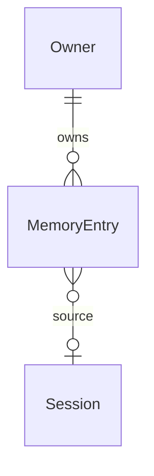

# Unity Catalog Memory & Recall

## Problem

A data team's most repeated conversation is context: "revenue on that table is net of refunds",
"the nightly job owns the partition", "we tried that join in March and it duplicated rows".
Clawhouse forgets all of it. `MEMORY.md` is read once into the system prompt
(`src/clawhouse/capabilities/bootstrap.py`, `agent/prompt.py` L126–143) and is platform-owned, not
user- or team-writable (ADR-0005). There is no memory search and no transcript search:
`store/store.py` exposes create/list/rename/delete/clear (L189–201) but no search, and
`api/app.py` has no search route. OpenClaw has both a memory subsystem and `sessions_search`
(`docs/concepts/memory.md`, `docs/concepts/session-search.md`). Evidence:
`docs/clawhouse-vs-openclaw.md` §3 rows 2–3.

When this ships, a user can search past sessions and table knowledge, and the agent answers with
cited, correctable memory instead of re-asking.

## Flow

This reuses the Lakebase store, the existing mention-context injection point, and the Sessions screen
instead of adding a memory service or a second database.

1. user saves memory or searches -> `clawhouse.api.app` (exists) routes `POST/GET/DELETE
   /api/memory` and `GET /api/search`
2. `clawhouse.store.store.SessionStore` (exists) gains `save_memory`, `list_memories`,
   `delete_memory`, and `search_transcripts`; the Lakebase implementation writes
   `clawhouse.memory_entries` (door 1) and queries the FTS index on
   `clawhouse.transcript_entries` (door 2)
3. turn -> `clawhouse.agent.turn` (exists) asks `clawhouse.capabilities.mentions` (exists) for a
   bounded memory block and appends it to the user prompt beside the existing mention context
4. `clawhouse.capabilities.mentions` (exists) also exposes `remember` and `recall` tools
   (`_capabilities_for_turn`, `turn.py` L564–599)
5. out: `GET /api/search` results -> `clawhouse.static.sessions` (exists) re-renders the session list

## Impact

| Front | What changes |
| --- | --- |
| domain | new term: Memory entry - one user-owned statement with provenance and an optional table; lives in `store/shapes.py` and `store/store.py` |
| domain | existing term: mention bundle - now carries memory in addition to table/file/skill context; who branches today: `resolve_mention_bundles` callers in `agent/turn.py` |
| stored data | new `clawhouse.memory_entries` table and a GIN index over existing `transcript_entries`; Postgres builds the index on open, no row backfill |
| screen | Sessions gains a search input and a results/empty/error state; no new screen (ADR-0004) |

## Relations

One-way constraints: `memory_entries.owner_id` not null; `memory_entries.text` not null;
`source_session_id` nullable and constrained to a session the owner owns; `table_fqn` nullable.

## Surface

Only routes this adds or whose signature changes.

| Route | In | Out | Status |
| --- | --- | --- | --- |
| `GET /api/search` | `q`, `limit` | `results[]` (`session_id`, `role`, `excerpt`, `created_at`) | `200`, `401`, `422` |
| `GET /api/memory` | `q`, `limit` | `entries[]` (`id`, `text`, `table_fqn`, `source_session_id`, `created_at`) | `200`, `401` |
| `POST /api/memory` | `text`, `source_session_id`, `table_fqn` | `id`, `text`, `created_at` | `201`, `401`, `404`, `422` |
| `DELETE /api/memory/{memory_id}` | none | none | `204`, `401`, `404` |

## Landing

| One-way door | Literal shape | Alternative rejected |
| --- | --- | --- |
| Memory persists in Lakebase | table `clawhouse.memory_entries` with `id uuid primary key`, `owner_id text not null`, `text text not null`, `source_session_id uuid null references clawhouse.sessions(id)`, `table_fqn text null`, `created_at timestamptz not null default now()` | per-user Markdown `MEMORY.md` in the workspace - needs OBO workspace write and app-enforced isolation; ADR-0005 keeps agent files platform-owned |
| Transcript search uses a Postgres GIN index | `CREATE INDEX IF NOT EXISTS transcript_search_idx ON clawhouse.transcript_entries USING GIN (to_tsvector('english', content))` | an external search service - new dependency and a second source of truth; `ILIKE '%q%'` - full scan, no ranking |
| Memory writes are explicit | the only write paths are `POST /api/memory` and the `remember` tool; no post-turn extraction writes entries | silent extraction after every turn - no provenance, cannot be audited or corrected |

- Nothing else in this change is hard to reverse.

## Criteria

Grouped by slice - one observable outcome each, never a layer.

### S1: Search past sessions (P1)

A user can find a phrase from an earlier session and reopen its context.

**Acceptance Criteria**

1. WHEN a caller requests `GET /api/search?q=<term>` THEN the system SHALL return at most `limit` results, each with `session_id`, `role`, an `excerpt` of at most 240 characters, and `created_at`, ordered newest first.
2. The system SHALL return only entries whose session `owner_id` equals the caller's identity.
3. IF `q` is empty or whitespace THEN the system SHALL return `422`.
4. IF no entry matches THEN the system SHALL return `200` with `results: []`.
5. WHEN the Sessions screen search input contains at least 2 characters THEN the system SHALL request `/api/search` and replace the list with matching rows.
6. IF the search request fails THEN the Sessions screen SHALL show an inline error and keep the previous list.

### S2: Durable, cited memory (P1)

A user can save a fact, see it again later, and have the agent use it with a citation.

**Acceptance Criteria**

7. WHEN a caller posts `text` THEN the system SHALL persist a `memory_entries` row with `owner_id`, `text`, `created_at`, and the optional `source_session_id` and `table_fqn`, and SHALL return `201` with `id` and `created_at`.
8. IF `source_session_id` names a session the caller does not own THEN the system SHALL return `404`.
9. WHEN a caller deletes an owned memory THEN the system SHALL delete the row and return `204`; a later `GET /api/memory` SHALL NOT include it.
10. WHEN a turn starts THEN the system SHALL inject at most 5 memory entries ranked by `ts_rank` then `created_at` descending, capped at 2,000 characters, each prefixed with its `id` and `created_at`.
11. The system SHALL inject only memory entries whose `owner_id` equals the caller's identity.
12. WHEN the model calls `recall(query)` THEN the system SHALL return a JSON array of at most 5 entries with `id`, `text`, `table_fqn`, `source_session_id`, and `created_at`.
13. WHEN the model calls `remember(text, table_fqn?)` THEN the system SHALL persist an entry for the caller and return its `id`.

**Independent test:** exercise the in-memory store for the four API routes and the two tools; one
Lakebase test asserts the FTS query returns the matching entry and never another owner's row.

## Out of scope

Product capabilities only.

| Excluded | Why |
| --- | --- |
| Vector embeddings / pgvector re-rank | lexical FTS first; embeddings are a reversible follow-up |
| Cross-user or team memory | isolation model is per-user, matching ADR-0005 |
| Automatic memory extraction / dreaming | explicit writes only in this slice (door 3) |
| Memory Wiki / imported memory | separate capability, not a data-team need |
| UC metadata refresh job | memory stores text now; validation is a follow-up |
| Transcript backfill beyond the index | the GIN index covers existing rows; no rewrite |

## Assumptions

| Assumption | Chosen default | Rationale | Confirmed? |
| --- | --- | --- | --- |
| Retrieval method | PostgreSQL full-text search (`to_tsvector` / `websearch_to_tsquery`) | no new dependency; reversible if ranking proves weak | n |
| Memory scope | per-user, not per-agent or per-team | matches the Lakebase owner boundary and ADR-0005 | n |
| Injection budget | 5 entries / 2,000 characters | bounds prompt growth while fitting a useful context block | n |
| Search unit | transcript entries, not whole sessions | gives an excerpt and a reopen target with the existing transcript API | n |
| Duplicates | allowed; `id` disambiguates | deduplicating text would need a similarity rule nobody asked for | n |

**Open questions:** none - all resolved or logged above.

## Observable

Worksheet, not the review. `n/a` needs its reason.

| Surface | Decision | Landing |
| --- | --- | --- |
| screen `sessions` | empty state | AC 4, 6 |
| screen `sessions` | loading state | AC 5 - the previous list stays until the response replaces it |
| screen `sessions` | error state | AC 6 |
| screen `sessions` | destructive action confirms | n/a - search has no destructive action; memory delete is a separate call |
| API `GET /api/search` | response and error shape | AC 1, 3 |
| API `POST /api/memory` | error shape and codes | AC 7, 8 |
| API `DELETE /api/memory/{id}` | error shape and codes | AC 9 |
| all new `/api/search`, `/api/memory*` | authorization | AC 2, 11 |
| all new `/api/*` | versioning and rate limits | n/a - internal app behind the Databricks proxy |
| tool `recall` / `remember` | output shape | AC 12, 13 |
| collection `memory_entries` | ordering | AC 10 |
| collection `memory_entries` | duplicates | n/a - identical text allowed; `id` disambiguates |
| collection `memory_entries` | destructive delete | AC 9 |

## Sources

- `.specs/features/unity-catalog-memory/intent.md` - problem, who, done
- `docs/clawhouse-vs-openclaw.md` §3 rows 2–3 - ranking and OpenClaw memory/search contrast
- `src/clawhouse/store/store.py` and `src/clawhouse/capabilities/mentions.py` - reuse points
- `docs/adr/0002-lakebase-workspace-storage.md`, `docs/adr/0005-platform-controlled-agent.md`
