# OpenClaw Control UI — Visual Reference (screenshots)

Companion to [`SCREENSHOTS.md`](SCREENSHOTS.md), which describes OpenClaw's Control UI
in text. That file explicitly recorded that **no PNGs were produced**. This file is the
missing half: 25 real, published product screenshots of the shipped Control UI,
downloaded into [`shots/`](shots/).

Status: reference material, not an ADR. Written to inform
[issue #22](https://github.com/matheusbuniotto/crabriks/issues/22) (refine the Crabriks
frontend to OpenClaw's design system).

## Provenance

Every image here is an **official screenshot published by the OpenClaw project** in its
own release notes — not a mock-up, not a capture of a third-party fork. They live in
OpenClaw's release notes and changelogs as markdown images served from
`https://github.com/user-attachments/assets/<uuid>`.

| Field | Value |
| --- | --- |
| Source repo | `openclaw/openclaw` |
| Releases covered | `2026.9.1`, `2026.9.2`, `2026.9.3`, `2026.9.4`, `2026.9.5`, `2026.10.1` |
| Extracted from | `docs/releases/<version>.md`, `CHANGELOG/<version>.md` (and `docs/gateway/team-server.md` for one image) |
| Extraction date | 2026-10-11 |
| Corpus available | 59 image URLs; 25 curated here |

Caveats to keep in mind while reading:

- All data in every screenshot is **fictional demo data** ("Harbor", "Waypoint"). Layout,
  chrome, and interaction affordances are real; the content is not.
- Several shots are **feature-focused crops** carried inside a release-note frame
  (`OPENCLAW / <version>` top-left, `PUBLISHED UI · FICTIONAL DATA` top-right, page
  caption along the bottom). The frame is release-note furniture — ignore it.
- `2026.9.6` → `2026.10.5` release notes contain **no** further UI screenshots, so
  `2026.10.1` is the newest visual evidence available.
- There is **no published screenshot of the approval / permission-prompt screen**, and
  **no screenshot of a light theme in use**. The nearest evidence is listed under those
  headings and the gap is called out explicitly.

## Index

| Screen (Crabriks v1) | Images |
| --- | --- |
| App shell + two-pane chat | [9.2 side chat](#1-app-shell--two-pane-chat), [9.4 review panel](#1-app-shell--two-pane-chat), [10.1 MCP app panel](#1-app-shell--two-pane-chat) |
| Chat — transcript rendering | [9.3 markdown table](#2-chat--transcript-rendering), [9.1 Mermaid](#2-chat--transcript-rendering), [9.5 citations](#2-chat--transcript-rendering) |
| Chat — composer + menus | [9.4 unsent draft](#3-chat--composer), [9.5 typing-not-sent](#3-chat--composer), [10.1 menu popover](#3-chat--composer) |
| Chat — tool activity | [9.5 outcome summaries](#4-chat--tool-and-run-activity), [9.5 activity recaps](#4-chat--tool-and-run-activity), [team-server task](#4-chat--tool-and-run-activity) |
| Sessions | [9.4 sessions](#5-sessions), [9.3 transcript search](#5-sessions), [9.1 catalog](#5-sessions) |
| New session | [9.1 controls](#6-new-session), [9.2 workspace picker](#6-new-session), [9.5 device picker](#6-new-session) |
| Approvals | [9.3 share menu](#7-approvals--permissions) *(nearest evidence)*, [9.5 recommendation](#7-approvals--permissions) |
| Status / settings / theme | [9.4 appearance](#8-status--settings--theme), [9.1 defaults](#8-status--settings--theme), [9.5 storage](#8-status--settings--theme), [10.1 mac setup](#8-status--settings--theme) |
| Agents roster | [9.5 agents overview](#9-agents-roster) |

---

## 1. App shell + two-pane chat

The single most important reference: a **persistent left rail** with the conversation in
the right pane. The rail is global chrome — it renders identically on chat, sessions,
automations, and settings, which is exactly what ADR-0004's "5 screens" currently lacks
(five separate HTML pages with a repeated top `<nav>`).

### `2026.9.2-chat-two-pane-side-chat.png`

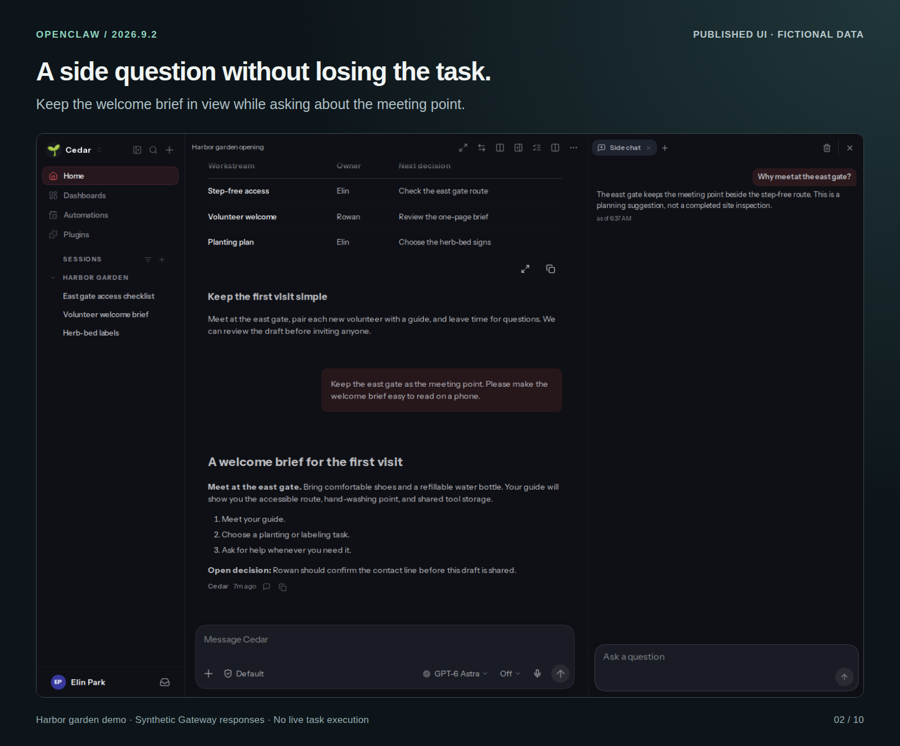

Source: `openclaw/openclaw` release 2026.9.2 ·
`https://github.com/user-attachments/assets/0a913719-e76f-4aec-88cc-457a59e2f8ee`

- **Three-column layout**: rail (≈290 px) · primary conversation · a secondary side-chat
  column. The side column has its own header and its own composer, so a user can ask a
  question *about* the conversation without polluting it.
- **Rail anatomy, top to bottom**: brand row (`Cedar` + collapse `◫` + search `🔍` +
  new `+`) → primary nav (`Home`, `Dashboards`, `Automations`, `Plugins`, each with a
  16 px line icon) → a `SESSIONS` uppercase micro-heading with filter and add actions →
  collapsible group headers (`⌄ HARBOR GARDEN`) → session rows as plain text labels →
  pinned footer with the user's avatar initials, display name, and a settings icon.
- **Active session** is a filled rounded pill with a slightly lighter surface and
  higher-contrast text; inactive rows are muted text with no background.
- The rail footer is a real ownership anchor: avatar + name means "you are signed in as".
  Crabriks shows this today as a floating `#who` paragraph in the header.

### `2026.9.4-chat-two-pane-review-panel.png`

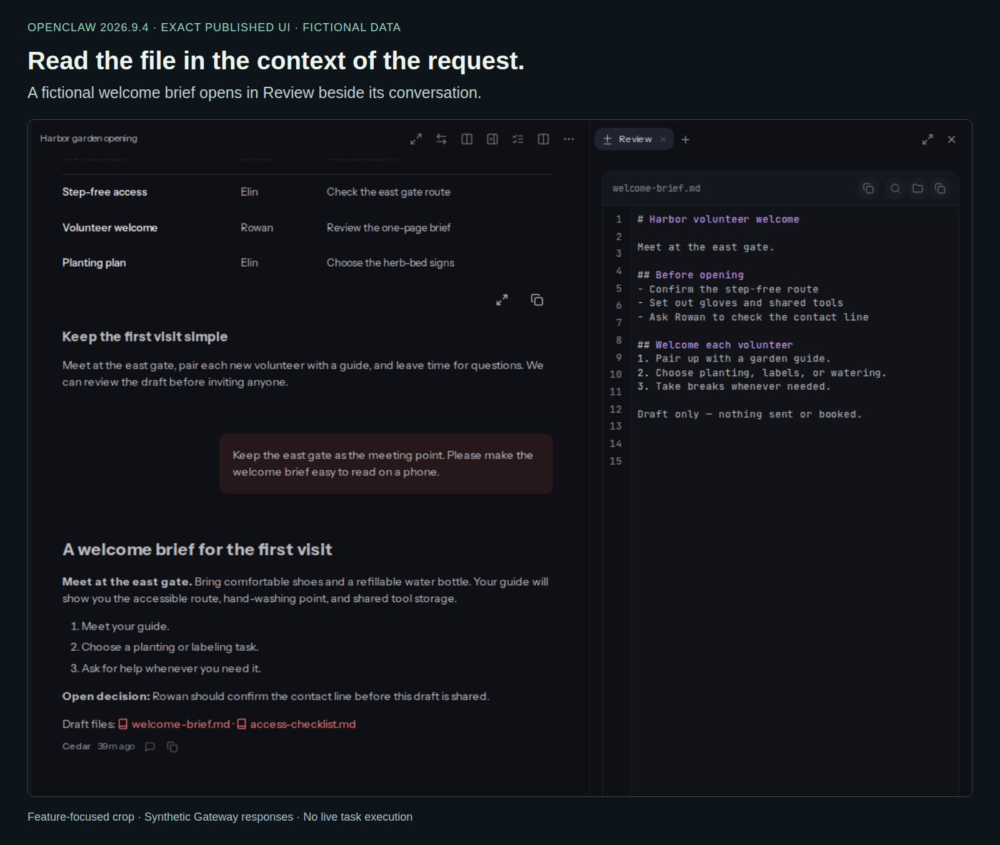

Source: `openclaw/openclaw` release 2026.9.4 ·
`https://github.com/user-attachments/assets/34dfa1d2-0bbe-4eb7-8695-1abfa3eb7d25`

- The right pane is a **swappable panel host**: the same slot serves Review, Dashboard,
  Files, Terminal, and the side chat. The chat header carries the panel toggles.
- The transcript column narrows rather than the panel overlaying it — the chat remains
  readable at all times, and text does not reflow into an unreadable measure.

### `2026.10.1-chat-side-panel-mcp-app.png`

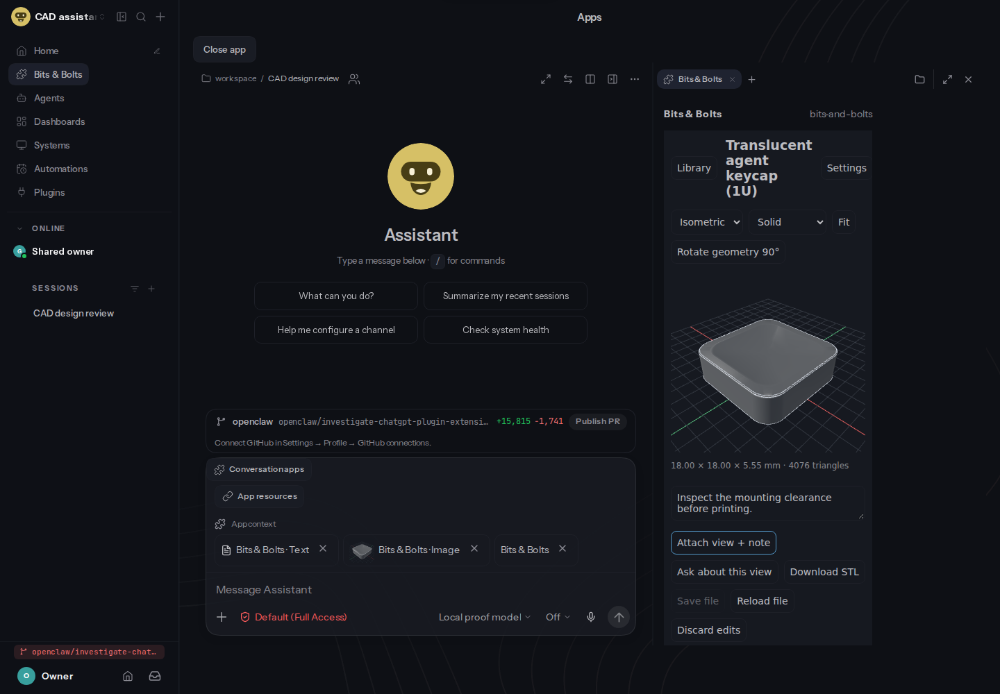

Source: `openclaw/openclaw` release 2026.10.1 ·
`https://github.com/user-attachments/assets/` (see `CHANGELOG/2026.10.1.md`)

- Newest available shot of the panel host. Shows that **content from a panel can be
  attached back into the composer** — the panel is a first-class input source, not a
  read-only viewer.

---

## 2. Chat — transcript rendering

### `2026.9.3-chat-markdown-table.png`

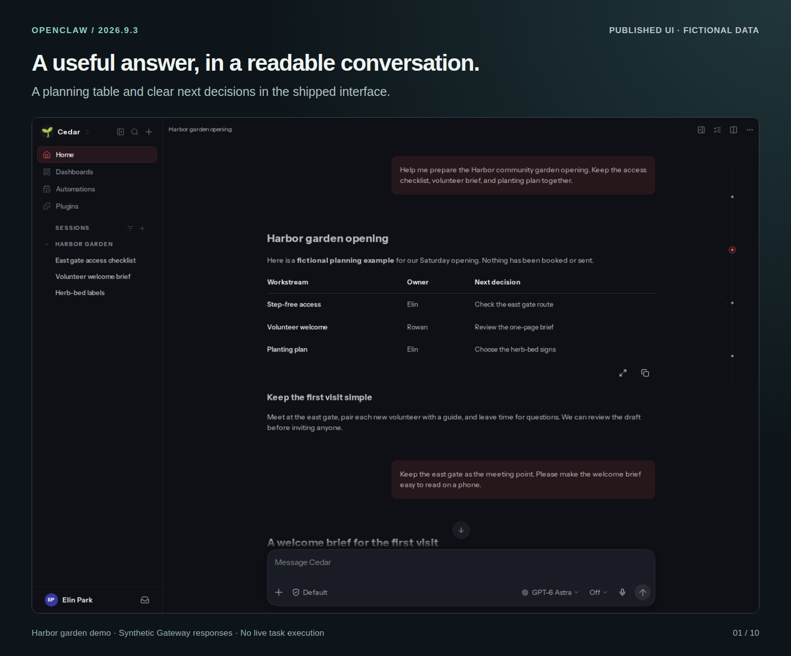

Source: `openclaw/openclaw` release 2026.9.3 ·
`https://github.com/user-attachments/assets/c5e47d33-273c-4513-af94-3335297d53ef`

This is the clearest single view of the shipped chat screen. Observable facts:

- **Dark canvas** with a soft radial accent glow behind the top-left of the app frame.
  The app frame itself is a rounded, bordered card inset from the page edge.
- **Asymmetric message treatment**: user messages are right-aligned, bounded, rounded
  rectangles with a warm tinted fill; assistant messages are **full-width prose with no
  bubble at all**. There is no "chat log of two bubbles" — assistant output reads as a
  document.
- **Real markdown**: the assistant renders a heading (`Harbor garden opening`), body
  paragraphs, inline code-style emphasis, and a **true table** with a header row and
  hairlined row separators. Today Crabriks sets `textContent` with
  `white-space: pre-wrap`, so none of this is reachable.
- **Per-message hover actions** sit below the assistant turn: expand (`⤢`) and
  copy (`⧉`), rendered as quiet icon buttons that do not occupy layout until hovered.
- **Scroll-spy rail** down the right edge of the transcript: a column of small dots, one
  per user/assistant turn, with the currently-visible turn marked in the accent color.
  Clicking a dot jumps to that turn. This is the single highest-leverage navigation
  affordance in a long transcript and it is cheap to build.
- **Floating scroll-to-bottom** circular button with a `↓` glyph, hovering just above
  the composer when the view is not at the bottom.
- **Composer** is a large rounded container (radius ≈ 20 px) titled by a placeholder
  (`Message Cedar`). Its toolbar is *inside* the container on a second row: attach `+`
  and a `🛡 Default` permission pill on the left; `GPT-6 Astra ⌄` model pill, an `Off ⌄`
  reasoning-effort pill, a microphone, and a filled circular accent send button with an
  up-arrow on the right.
- Chat header: conversation title on the left, then a right cluster of four quiet icon
  buttons (panel toggle, list/filter, layout, overflow `⋯`).

### `2026.9.1-chat-mermaid-diagram.png`

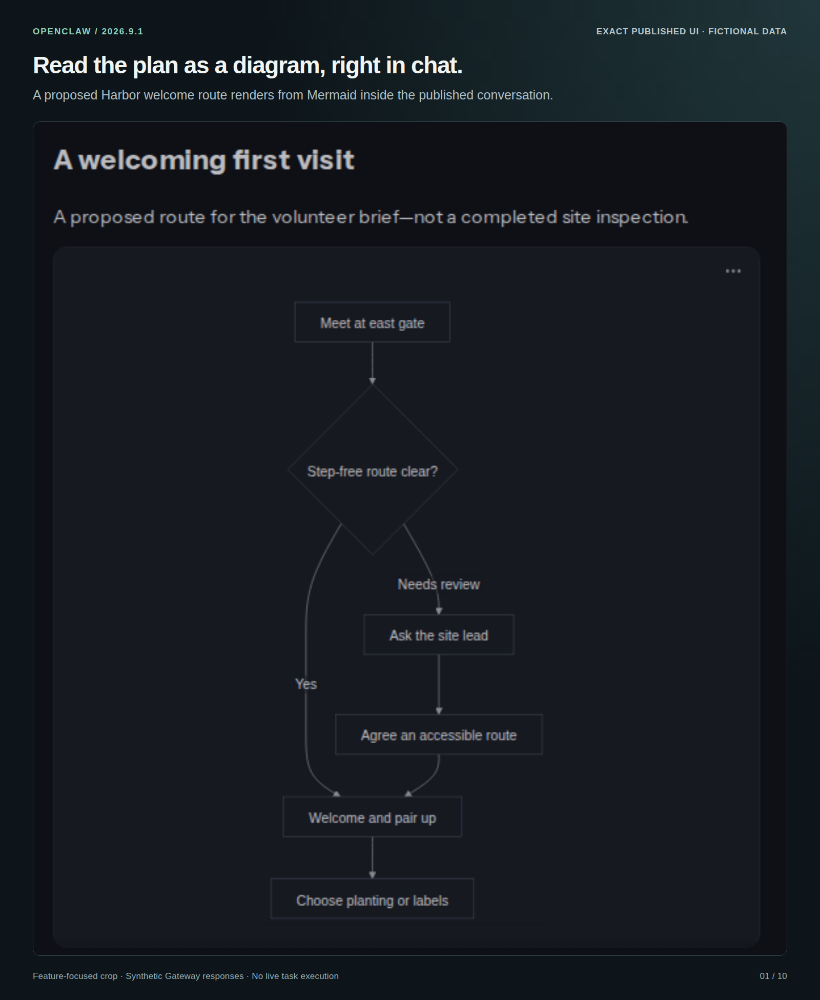

Source: `openclaw/openclaw` release 2026.9.1 ·
`https://github.com/user-attachments/assets/8c738afe-4d5f-4c8a-95e8-79aca5092ea5`

- Diagrams are **rendered in the transcript**, not shown as source. Evidence that the
  renderer is a real markdown pipeline with extensions, not a formatter.

### `2026.9.5-chat-answer-with-citation.png`

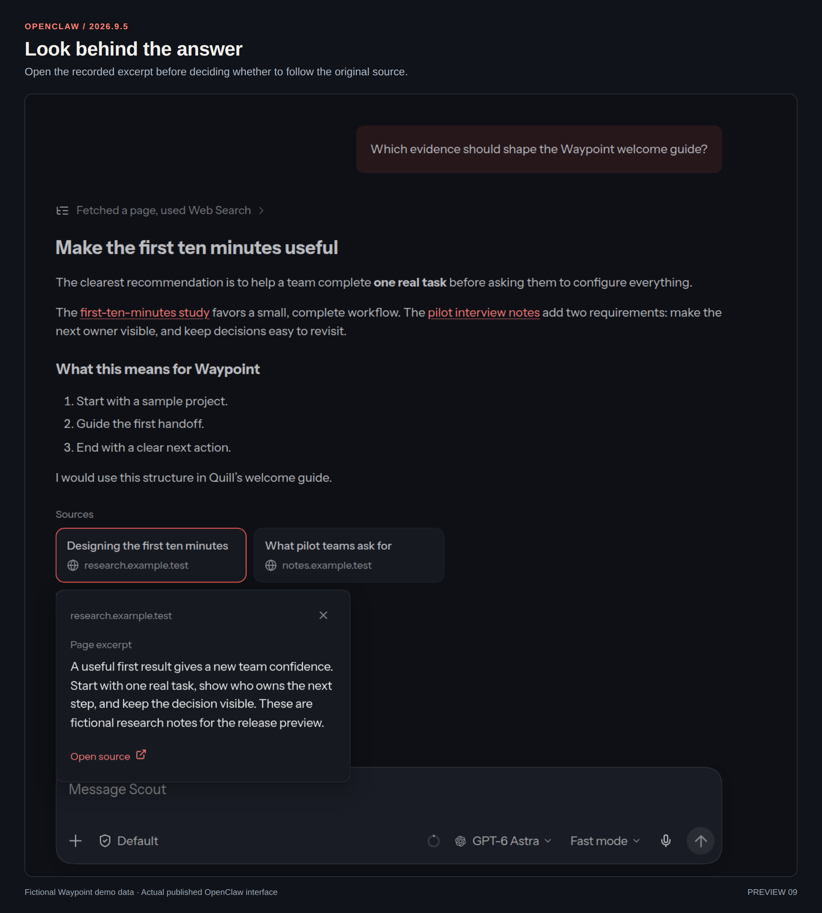

Source: `openclaw/openclaw` release 2026.9.5 ·
`https://github.com/user-attachments/assets/38bafb5d-267e-45c7-a72d-05f7b1331484`

- Long-form answers keep **citations and excerpts visually subordinate to the prose**
  (indented/quoted treatment) rather than as equal-weight paragraphs.

---

## 3. Chat — composer

### `2026.9.4-composer-unsent-draft.png`

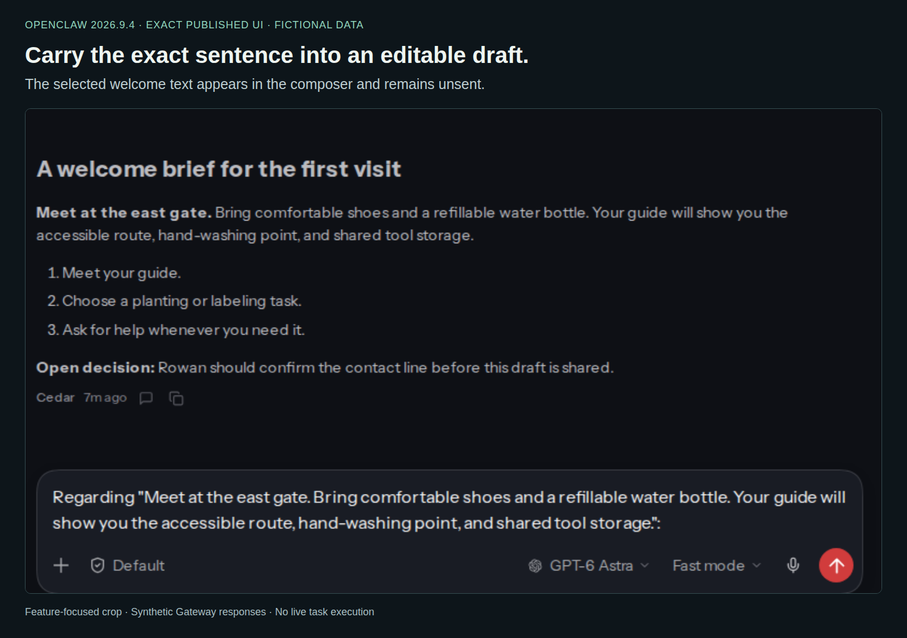

Source: `openclaw/openclaw` release 2026.9.4 ·
`https://github.com/user-attachments/assets/7fe220b5-4204-4247-952d-173611f64893`

- The composer **grows to fit its content** and keeps multi-line text legible with the
  toolbar still pinned at the bottom edge of the container.
- Inserted text lands in the composer without auto-sending — editing before sending is
  the default, and it survives leaving and returning to the screen.

### `2026.9.5-composer-typing-not-sent.png`

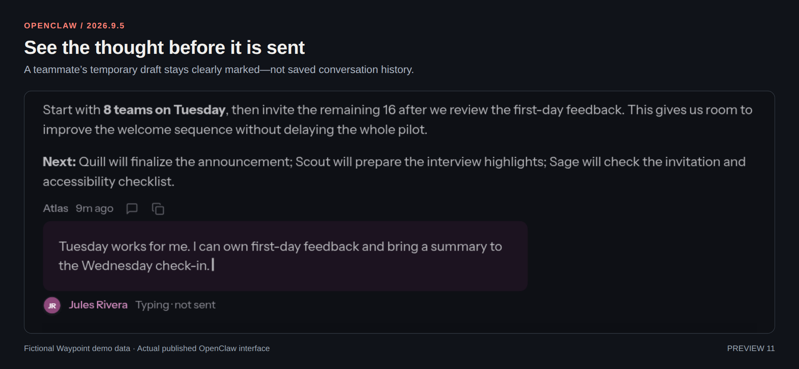

Source: `openclaw/openclaw` release 2026.9.5 ·
`https://github.com/user-attachments/assets/567af7e1-81bf-470e-a281-80627f1114f7`

- Draft state is **labelled explicitly** (`Typing · not sent`) so a reader never mistakes
  an unsubmitted draft for a delivered message. This is a trust affordance, not decoration.

### `2026.10.1-chat-menu-popover.png`

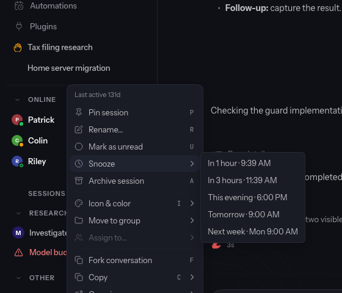

Source: `openclaw/openclaw` release 2026.10.1 · `CHANGELOG/2026.10.1.md`

- Popover/menu treatment: elevated surface, `10 px` radius, `28 px` item rows with
  `6 px` item radius, quiet hover fill, no heavy borders or drop shadows.
- Menus are the overflow pattern for secondary actions — the chrome stays uncluttered.

---

## 4. Chat — tool and run activity

### `2026.9.5-tool-activity-outcome-summaries.png`

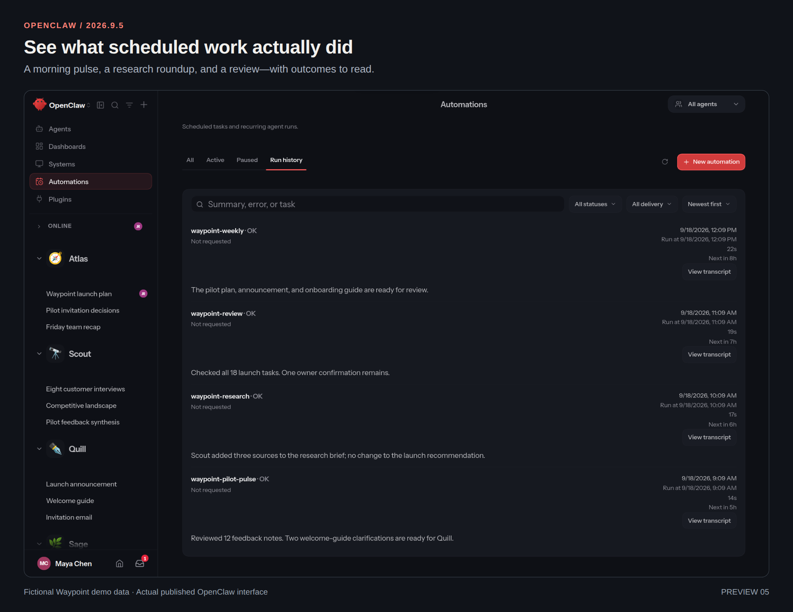

Source: `openclaw/openclaw` release 2026.9.5 ·
`https://github.com/user-attachments/assets/a223d017e...` (see `CHANGELOG/2026.9.5.md`)

- **The key lesson for Crabriks.** Today we render one flat `p.tool` line per
  `tool_call`/`tool_result` frame. OpenClaw renders an **outcome row**: an identifier in
  monospace (`waypoint-weekly`) with a **status chip** beside it (`OK`, green text on a
  translucent green pill), a state line (`Not requested`), a right-hand meta column of
  right-aligned facts (`9/18/2026, 12:09 PM` · `Run at …` · `22s` · `Next in 8h`), and a
  bordered secondary `View transcript` button — then a **one-sentence human summary** of
  what actually happened.
- Rows are separated by hairlines with generous vertical rhythm; long activity lists stay
  scannable because every row has the same shape.
- Tab strip above the list (`All` / `Active` / `Paused` / `Run history`) uses an
  accent-colored underline on the active tab plus a **primary filled accent button**
  (`＋ New automation`) on the far right.
- Filter row under the tabs: search input on the left, then a row of compact
  `⌄` dropdown pills (`All statuses`, `All delivery`, `Newest first`).
- The rail here proves the **grouping** model: each agent is a collapsible group
  (avatar + name + `⌄`), its sessions nested beneath, and a presence dot (magenta) marks
  rows with activity.

### `2026.9.5-tool-activity-recaps.png`

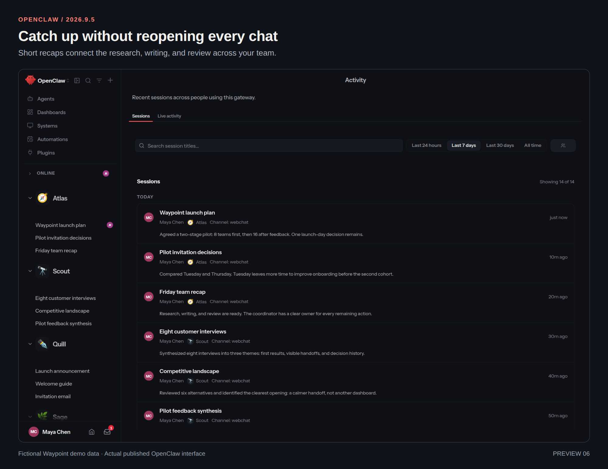

Source: `openclaw/openclaw` release 2026.9.5 · `CHANGELOG/2026.9.5.md`

- Activity is summarised **per agent**, not as one undifferentiated global stream.

### `2026.9.5-team-server-task-tests-pr.png`

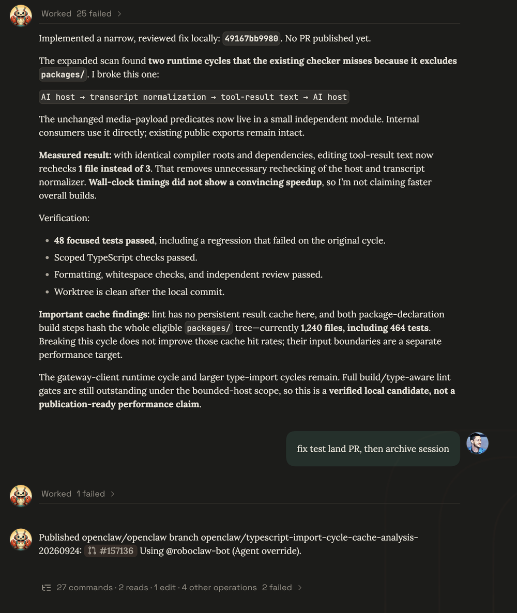

Source: `openclaw/openclaw` `docs/gateway/team-server.md` ·
`https://github.com/user-attachments/assets/b64f4d3a-3988-4f59-ac73-27552b6bdd30`

- The closest published view of a **run summary**: analysis, test results, and an output
  artifact (a published PR) grouped as one unit with a verdict.

> **Gap:** no published screenshot shows the *inline tool-call card* in a live transcript
> — the collapsed single-line row with a running/ok/error badge and an expandable
> input/output, or an inline diff with `+added` / `-removed` line numbers. `SCREENSHOTS.md`
> §01 describes it; the images above are the nearest shipped equivalents. Read those two
> together.

---

## 5. Sessions

### `2026.9.4-sessions-projects.png`

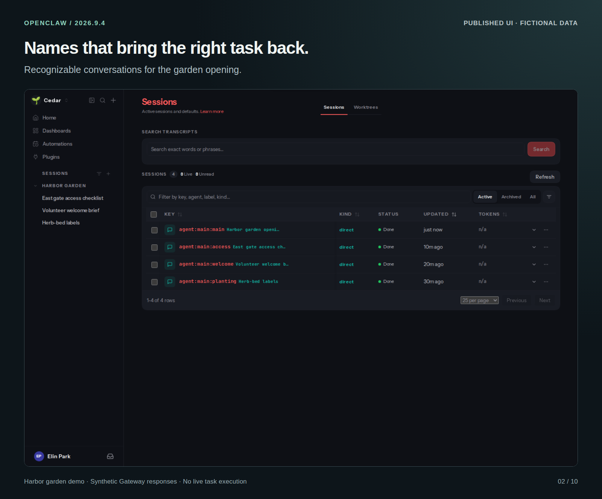

Source: `openclaw/openclaw` release 2026.9.4 ·
`https://github.com/user-attachments/assets/e54a3baf-fb6f-475f-a1c9-652478f9beff`

- Page title `Sessions` is rendered **in the accent color**, with a muted one-line
  subtitle and an accent `Learn more` link — a repeated page header pattern.
- **Segmented tabs** (`Sessions` / `Worktrees`) with an accent underline on the active tab.
- `SEARCH TRANSCRIPTS` micro-heading, then a full-width search field with the primary
  filled accent `Search` button *inside* the field's right edge.
- A count row (`SESSIONS  4  0 Live  0 Unread`) with a secondary `Refresh` button.
- A **filter row**: search-icon input (`Filter by key, agent, label, kind…`) plus a
  segmented `Active | Archived | All` control and a filter icon button.
- A real **data table**: checkbox · `KEY` · `KIND` · `STATUS` · `UPDATED` · `TOKENS`,
  each header carrying a sort glyph (`⇅`). The key cell is a chat icon + an
  accent-colored machine prefix (`agent:main:main`) + the human title. `KIND` renders as
  a tinted token (`direct`), `STATUS` as a green dot + `Done`, `UPDATED` as a relative
  time (`just now`, `10m ago`). Each row ends with a disclosure chevron and an overflow `⋯`.
- Table footer: `1-4 of 4 rows`, a `25 per row` page-size select, and `Previous` / `Next`.

> This screen is the biggest single delta from Crabriks' current `sessions.html`, which is
> a bare `<ul>` of links.

### `2026.9.3-sessions-transcript-search.png`

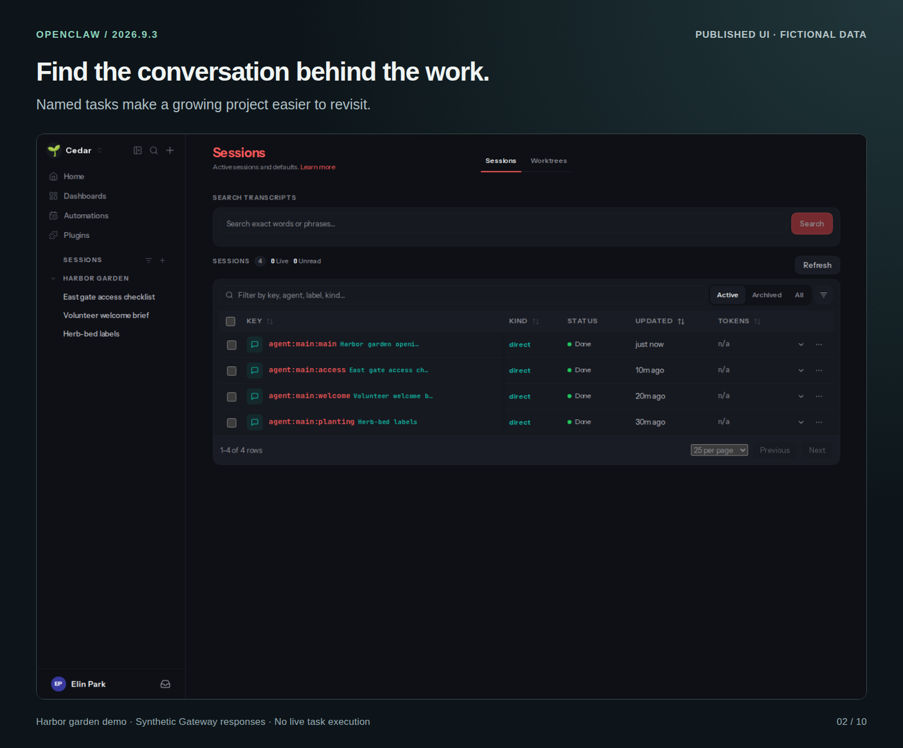

Source: `openclaw/openclaw` release 2026.9.3 ·
`https://github.com/user-attachments/assets/9cc2dd61-f187-4489-8c04-420a94403540`

- Session rows are **labelled, not numbered**: a readable title is the primary key.
  Crabriks currently shows a raw `created_at` timestamp as a row's main content.

### `2026.9.1-sessions-catalog.png`

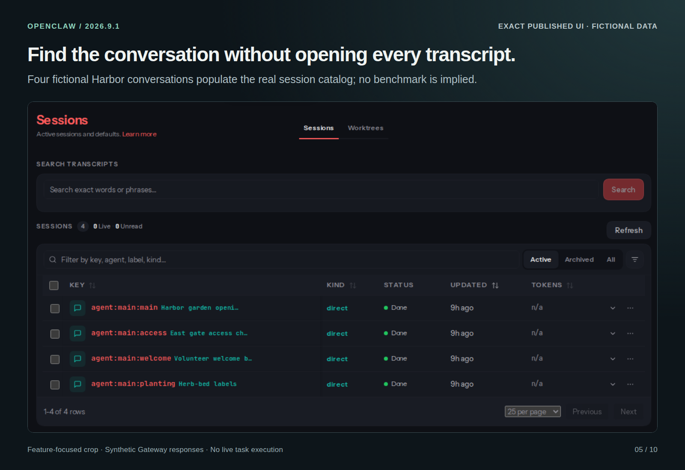

Source: `openclaw/openclaw` release 2026.9.1 ·
`https://github.com/user-attachments/assets/08c6c1fc-1ac7-4c72-bef6-f677f44b71e6`

- Earliest view of the catalog; shows how a short list reads when the rail and the list
  are both present (the rail is navigation, the page is the dataset).

---

## 6. New session

### `2026.9.1-new-session-controls.png`

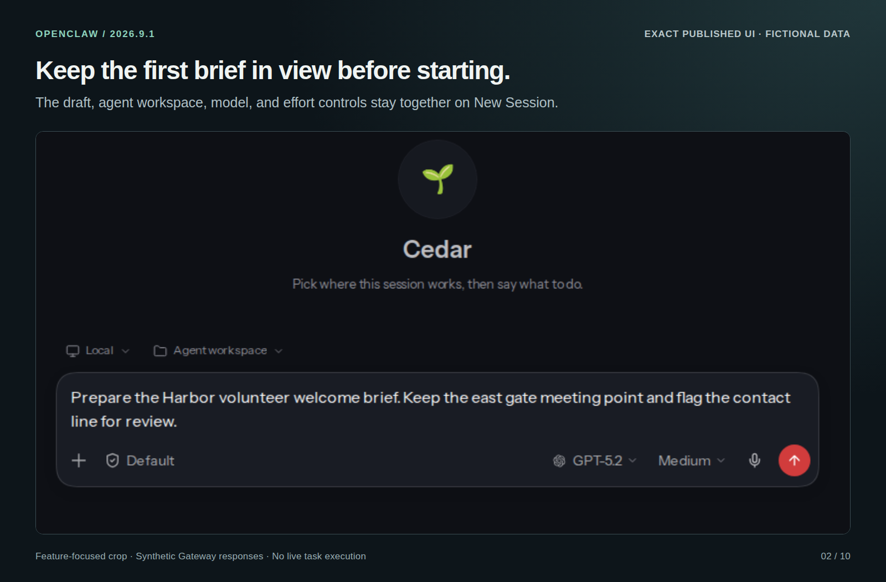

Source: `openclaw/openclaw` release 2026.9.1 ·
`https://github.com/user-attachments/assets/2193783b-9495-4f7d-b260-8663c66b9891`

- **Empty-state hero**: a large circular agent avatar, the agent name (`Cedar`) set large
  and bold, and a one-line instruction (`Pick where this session works, then say what to
  do.`) — the screen explains itself instead of presenting a bare form.
- **Context pickers sit directly above the composer**, not in a separate form:
  `🖥 Local ⌄` and `📁 Agent workspace ⌄`.
- The composer is the *primary control*: the brief is typed, not pasted into a textarea
  in a form with a submit button.
- The **filled accent circular send button** is the only saturated element on the screen,
  which is what makes the primary action unambiguous.

### `2026.9.2-new-session-workspace-picker.png`

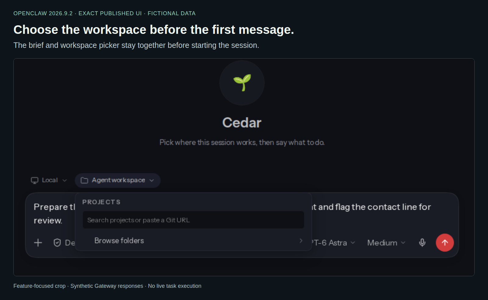

Source: `openclaw/openclaw` release 2026.9.2 ·
`https://github.com/user-attachments/assets/c4f51d00-d735-423f-9f97-1ac46db355c8`

- The picker opens **in place**, keeping the typed brief visible and unsubmitted —
  choosing a workspace never discards the draft.

### `2026.9.5-new-session-device-picker.png`

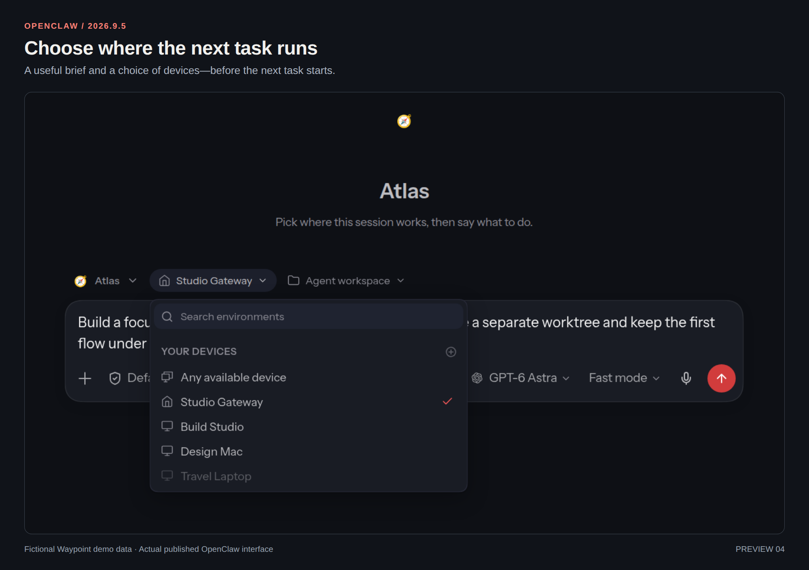

Source: `openclaw/openclaw` release 2026.9.5 · `CHANGELOG/2026.9.5.md`

- Pickers enumerate **availability** (`available` / `offline`), so a user can see why an
  option is unusable instead of finding out after submitting.

> **Porting note:** Crabriks has no device concept. The transferable part is the *pattern*
> — an in-place picker above the composer whose options carry a state, with the draft
> preserved. For us the natural equivalent is the platform workspace / agent selection.

---

## 7. Approvals — permissions

**There is no published screenshot of the approval / permission-prompt screen in the
entire downstream release corpus (2026.9.1 → 2026.10.5).** `SCREENSHOTS.md` §05 describes
it in text. The two images below are the nearest shipped evidence for how OpenClaw
presents *permission-shaped decisions*, and the gap is worth recording.

### `2026.9.3-approval-share-menu.png`

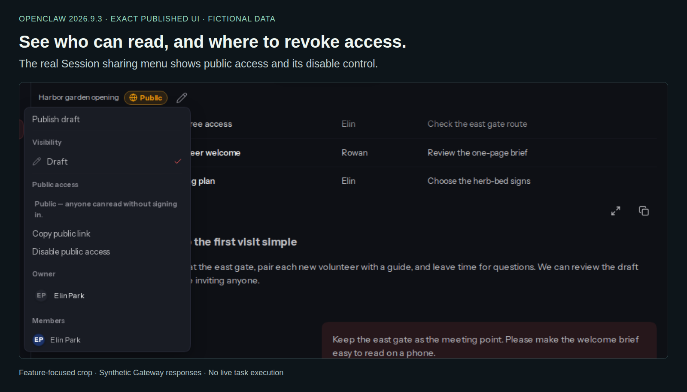

Source: `openclaw/openclaw` release 2026.9.3 ·
`https://github.com/user-attachments/assets/36c88eee-e444-4177-85a9-45c481904de2`

- A consequential, reversible action is given a **named state and an explicit disable
  control**, in an elevated menu — the weight of the action matches the weight of the UI.

### `2026.9.5-approval-recommendation-comment.png`

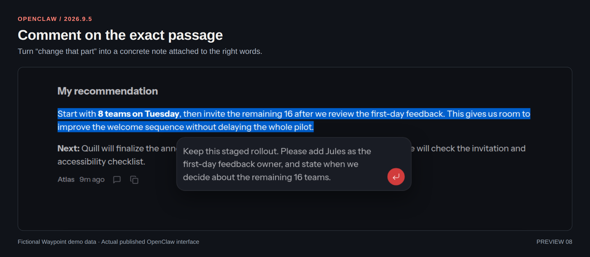

Source: `openclaw/openclaw` release 2026.9.5 · `CHANGELOG/2026.9.5.md`

- Decision surfaces attach **context to the choice**: who owns the follow-up, and when it
  is next reviewed. Approval is not a bare yes/no button.

> **Crabriks-specific:** our approvals screen is the only one of the five with **zero CSS
> rules** — `approval-card`, `btn-approve`, `btn-deny`, `args-json` do not exist in
> `chat.css`. It currently renders unstyled. See `CURRENT-STATE.md`.

---

## 8. Status / settings / theme

### `2026.9.4-settings-appearance-theme-accent.png`

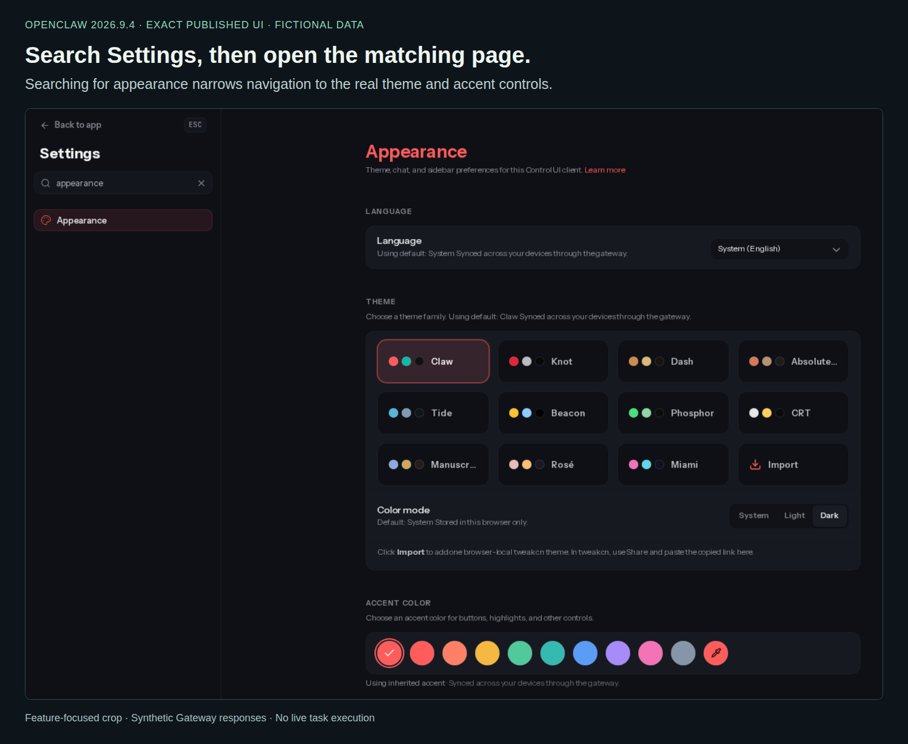

Source: `openclaw/openclaw` release 2026.9.4 ·
`https://github.com/user-attachments/assets/c1ed95a2-0ea9-400b-85db-2fbfb5d3bb50`

- **Theme and accent are user-facing controls**, not hard-coded values — direct evidence
  that the design is token-driven end to end. OpenClaw ships 10 palettes
  (`ui/public/themes/*.css`) plus a light/dark mode axis.
- Settings navigation is **searchable**, and searching narrows the nav to matching
  destinations rather than filtering a separate result list.

### `2026.9.1-settings-defaults-card.png`

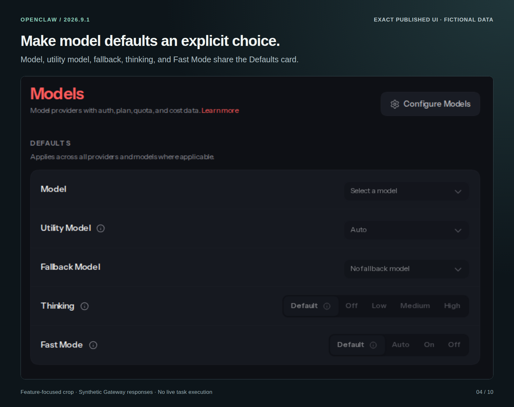

Source: `openclaw/openclaw` release 2026.9.1 ·
`https://github.com/user-attachments/assets/f7fdec9e-c58e-417d-941a-fddabcedff06`

- Related settings are **grouped into one card** with a single heading, instead of one
  control per row spread across a page.

### `2026.9.5-settings-storage.png`

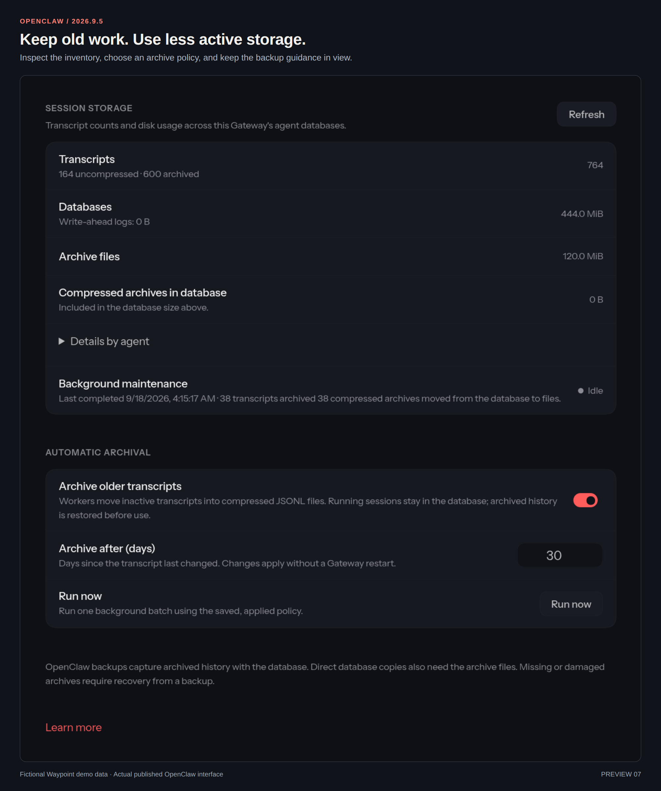

Source: `openclaw/openclaw` release 2026.9.5 · `CHANGELOG/2026.9.5.md`

- Diagnostic/destructive settings pair **counts with the policy** that consumes them.

### `2026.10.1-status-mac-setup.png`

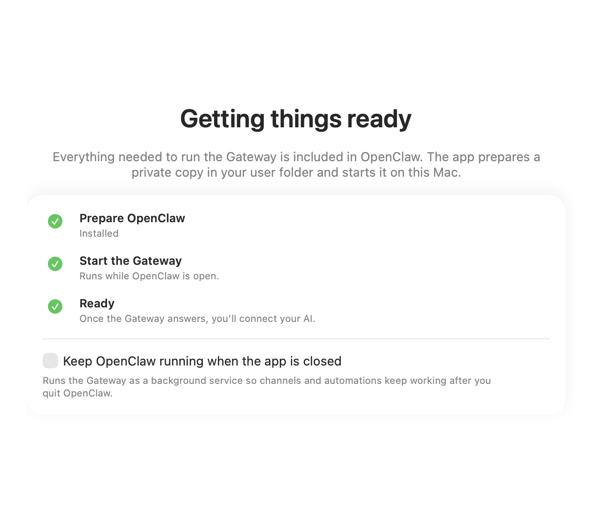

Source: `openclaw/openclaw` release 2026.10.1 · `CHANGELOG/2026.10.1.md`

- A status/health screen states what is **included and running** with an explicit,
  labelled toggle — a good model for our `status.html` connectivity block.

---

## 9. Agents roster

### `2026.9.5-agents-overview.png`

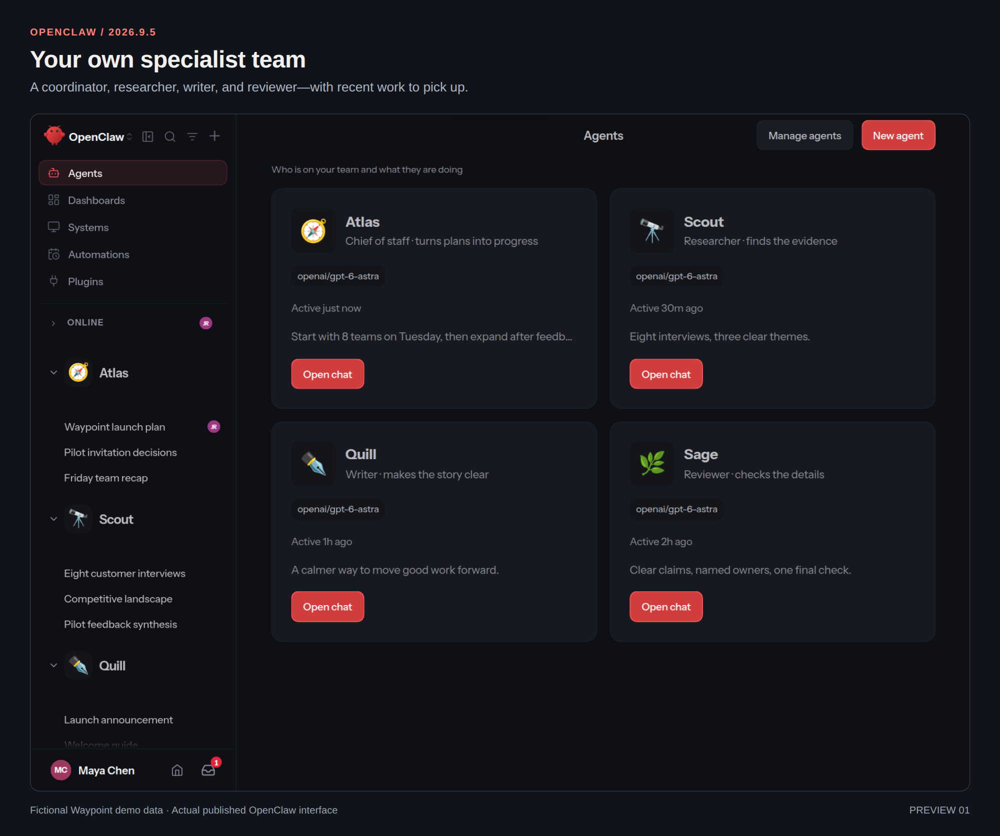

Source: `openclaw/openclaw` release 2026.9.5 · `CHANGELOG/2026.9.5.md`

- Identity is carried by a small avatar + name + preview of recent work in a consistent
  card, reused everywhere the agent appears.

---

## Cross-cutting observations

These hold across the whole set and are what "matching the OpenClaw design system"
actually means in practice. Values below are read from the shipped token files
(`ui/src/styles/base.css`, `ui/src/styles/layout.css`, `ui/public/themes/*.css`) and
should be treated as the target contract.

### Color and surfaces

- **Dark is the default, not a fallback.** Canvas `--bg: #0e1015`, with a bounded
  five-step surface ladder: `--bg-accent #13151b` → `--card #161920` →
  `--bg-elevated/--popover #191c24` → `--bg-hover/--bg-muted #1f2330`. Depth is expressed
  by stepping the surface, not by adding shadows.
- **One accent, used sparingly.** Signature red `--accent: #ff5c5c` (hover `#ff7070`,
  subtle `rgba(255,92,92,0.1)`), with `--primary: #d13c3c` for filled buttons and
  `--ring: #ff5c5c` for focus. In the screenshots the accent appears almost exclusively
  on: the active nav/tab indicator, the primary action button, links, and the page title.
  Everything else is neutral. **This is the difference between "a red-accented design" and
  "a dark design with one red thing in it."**
- **Borders, not shadows.** `--border #1e2028`, `--border-strong #2e3040`,
  `--border-hover #3e4050`. Only popovers elevate.
- **Text is deliberately capped below maximum contrast.** `--text #bcbcc0`,
  `--text-strong #f4f4f5`, `--muted #8b8b94`. Body text sits near 10:1 rather than pure
  white on black, because pure white halates on dark backgrounds.
- **Status is designed as a label/background pair.** `--ok #22c55e`, `--warn #f59e0b`,
  `--danger #f87171`, `--info #60a5fa`, each paired with an 8% `-subtle` tint that the
  label actually sits on — exactly the `OK` chip in the activity screenshot.
- **Light mode is a mode, not a palette swap.** `:root[data-theme-mode="light"]`; theme
  files are separate (`ui/public/themes/<name>.css`) and each carries its own WCAG audit
  comment.

### Geometry and type

- **Radii are a scale.** `--radius-sm 6px`, `--radius-md 10px` (= `--radius`),
  `--radius-lg 14px`, `--radius-xl 20px`, `--radius-full 9999px`. Menus are pinned to
  `--menu-radius: var(--radius-md)` and `--menu-item-radius: var(--radius-sm)` so transient
  surfaces cannot drift from the panel radius.
- **Fixed geometry tokens for controls.** `--menu-item-height: 28px`, rail action buttons
  28 px with a 16 px glyph at `--rail-header-action-gap: 2px`.
- **Rail is a named contract.** `--rail-header-height: 48px`, `--resize-handle-size: 6px`
  with a 1 px resting line that becomes 2 px on hover, and the shell itself is
  `grid-template-columns: var(--shell-nav-width) minmax(0,1fr)`. On desktop
  `--shell-topbar-height: 0px`, because the sidebar *is* the navigation. Collapse is
  `.shell--nav-collapsed { grid-template-columns: 0 1fr }` + `⌘B`. **The rail is
  drag-resizable — a first-class feature, not an afterthought.**
- **Type scale is a token set**: `--control-ui-text-xs 11px`, `sm 12px`, `md 14px`,
  `lg 16px`, each multiplied by `--control-ui-text-scale`. Body is 14px/1.55 with
  `letter-spacing: -0.01em`. Inputs are forced to `max(16px, …)` to suppress iOS zoom.
- **Typefaces are a token pair**: `--font-body` ("Instrument Sans" + system stack), a
  separate `--font-chat` for prose, and a dedicated terminal/mono face. Crabriks currently
  `@import`s Google Fonts at the top of `chat.css` — a third-party request on the critical
  path of a Databricks app — and hard-codes the mono family twice.

### Interaction

- **The rail, not the page, owns navigation.** Switching sessions is an in-place render,
  never a full document load. This is the structural change that makes the other polish
  possible.
- **Assistant output is a document, not a bubble.** Full-width prose, real markdown,
  tables, diagrams, per-message copy/expand on hover.
- **Scannable activity rows.** Fixed row shape: identity + status chip + right-aligned
  facts + one-line human summary.
- **Toolbars live inside the composer**, as a second row within one rounded container.
- **Drafts are labelled and preserved.** `Typing · not sent`; leaving a screen does not
  discard input.
- **Every list has loading, empty, and error states** — the skeleton primitive is
  `--skeleton-base` with a 1.5 s shimmer, `border-radius: var(--radius-md)`, disabled
  under `prefers-reduced-motion`.
- **Micro-headings are consistent**: uppercase, letter-spaced, muted, 11–12 px
  (`SESSIONS`, `SEARCH TRANSCRIPTS`) — used to label every region.

### What this means for Crabriks

The realistic v1 target is **not** this full surface. It is the smallest set of changes
that makes the five ADR-0004 screens read as the same product as the screenshots above:

1. a token layer (surfaces, one accent, radii, type scale) replacing 12 ad-hoc variables,
2. a persistent session rail with in-place session switching,
3. dark-by-default with one accent,
4. markdown rendering in the transcript,
5. activity rows with real states instead of flat text lines,
6. and styled, not unstyled, Approvals.

`CURRENT-STATE.md` records what we have today against exactly these six.
