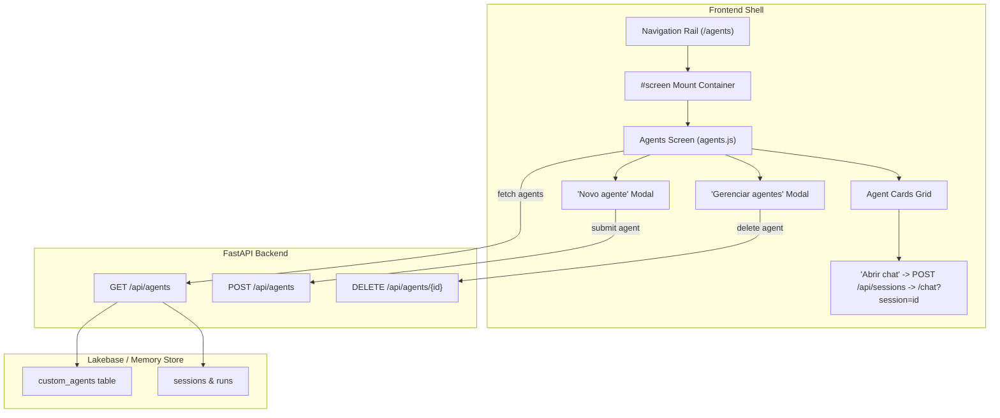

# Design: Agents Management & Selection UI (`/agents`)

Status: confirmed by matheus, 2026-10-15

## 1. Situation

Clawhouse is a Databricks-native port of OpenClaw running as a FastAPI backend with a vanilla TypeScript/HTML shell, Lakebase Postgres persistence, and Pydantic AI for execution turns.

- **Current state**: Custom agents can be registered in the backend (`/api/agents`), workspaces are provisioned on disk (`AGENTS.md`, `SOUL.md`, `CONTEXT.md`), and sessions can be addressed to specific agents (`@agent_name`). However, the UI currently has no dedicated agents screen: agent creation and selection was temporarily crammed into `/new` (New Session), and there is no visible overview of who is in the workspace or what they are doing.
- **Reference**: OpenClaw's `/agents` screen (captured live at `http://127.0.0.1:18789/agents` and documented in `docs/openclaw-ui/SHOTS.md` §9-10). It features a dedicated route (`/agents`), header with "Agentes", subtitle "Quem está na sua equipe e o que está fazendo", actions "Gerenciar agentes" and "Novo agente", and a responsive card grid showing avatars, models, activity status, and direct "Abrir chat" launch buttons.
- **What is at stake**: High product visibility, zero breaking database migrations. Reversible presentation and routing changes that establish the multi-agent operating surface for Clawhouse.
- **Work in flight**: Lakeflow Jobs deep analysis and schedules are settled; `/jobs` was added as a 6th screen. `/agents` becomes the 7th first-class screen.

---

## 2. Problem

- **Kind**: Problem of Absence.
- **Who is affected**: Workspace operators and end users who want to discover, inspect, launch, or create specialized agents.
- **Substitute today**: Operators must use the cluttered `/new` screen to fill out nested forms or memorize handles to type `@mentions` directly in chat without knowing which agents exist or what models/instructions they run.
- **What counts as worked**:
  - **Worked if**: An operator navigates to `/agents`, sees all platform and custom agents with their status and model, and can click "Abrir chat" to start a session immediately with that agent as the session default, or create a new agent via modal within 30 seconds.
  - **Early signal**: Users create and initiate turns with custom agents directly from `/agents` rather than falling back to default `main` exclusively.
  - **Review**: End of v1 iteration cycle.

---

## 3. Shape

Two shapes were considered:

- **Shape A (Recommended & Selected) — Dedicated `/agents` Screen + Modals**:
  - Adds `/agents` to the primary navigation rail.
  - Renders a clean team grid of agent cards showing avatar, name, model, last active timestamp, last activity preview, and "Abrir chat" CTA.
  - Houses "Novo agente" creation and "Gerenciar agentes" list/deletion in accessible overlay modals/drawers.
  - Cleans up `/new` to focus solely on session creation.
- **Shape B (Discarded) — Conversational Agent Maker within Chat Transcript**:
  - Emulates OpenClaw 2026.9.5 agent maker where creating an agent is an interactive conversation turn with the platform agent.
  - *Disqualification condition*: Requires an active LLM loop with structured tool calling and schema synthesis to generate `AGENTS.md`/`SOUL.md` before an agent can even be viewed, adding latency, prompt tokens, and non-deterministic failures for simple configuration.

---

## 4. Architecture & Critical Path



---

## 5. Work Index

| Slice | Title | Complexity | Readiness |
|---|---|---|---|
| **Slice 1** | Rail Navigation & Route Mounting (`/agents`) | Low | Ready |
| **Slice 2** | Enriched Agent API (`GET /api/agents` with model & recency) | Low | Ready |
| **Slice 3** | Agents Overview Grid Screen (`agents.js` & CSS) | Medium | Ready |
| **Slice 4** | "Novo agente" & "Gerenciar agentes" Modals + `/new` Cleanup | Medium | Ready |

---

## 6. Vertical Slices

### Slice 1: Rail Navigation & Route Mounting

- **Diff**:
  - `src/clawhouse/static/index.html`: Add `<a class="rail-link" id="nav-agents" data-nav href="/agents">Agentes</a>` under Primary Navigation.
  - `src/clawhouse/static/shell.js`: Add `"/agents": "Clawhouse · Agentes"` to `TITLES`, and `"/agents": () => import("./agents.js")` to `ROUTES`.
  - `src/clawhouse/api/app.py`: Ensure `GET /agents` serves `index.html` (matches client-side routing fallback).
- **Flow**: User clicks "Agentes" on the rail -> History API navigates to `/agents` -> `agents.js` is dynamically imported and mounted into `#screen`.
- **States**: Inactive, Active (`aria-current="page"`).

---

### Slice 2: Enriched Agent API

- **Diff**:
  - `src/clawhouse/api/app.py`: Enhance `CustomAgentOut` model and `GET /api/agents` to populate:
    - `model`: configured default model or provider identifier (e.g. `databricks-meta-llama-3-3-70b-instruct`).
    - `last_active_at`: ISO timestamp of the agent's most recent run/turn from `transcript_entries` or `sessions` (or `None`).
    - `last_activity`: short preview string of recent task/prompt (or description fallback).
- **Contract**:
  ```json
  [
    {
      "id": "platform-main",
      "owner_id": "platform",
      "name": "main",
      "description": "Clawhouse platform agent",
      "system_prompt": "",
      "signature_emoji": "🦀",
      "is_platform": true,
      "model": "databricks-meta-llama-3-3-70b-instruct",
      "last_active_at": "2026-10-15T22:00:00Z",
      "last_activity": "Heartbeat & platform operations"
    }
  ]
  ```
- **Key decision**: Querying `last_active_at` uses an index lookup or cached session summary so `GET /api/agents` remains sub-10ms.

---

### Slice 3: Agents Overview Grid Screen (`agents.js`)

- **Diff**:
  - New `src/clawhouse/static/agents.js`: Implements `mount(screen, { url, navigate })`.
  - `src/clawhouse/static/screens.css`: Add styling for `.agents-page`, `.agents-header`, `.agents-grid`, `.agent-card`, `.agent-card-avatar`, `.agent-card-title`, `.agent-card-model`, `.agent-card-activity`, `.btn-open-chat`.
- **Behavior**:
  - Displays header:
    - Title: **Agentes**
    - Subtitle: *Quem está na sua equipe e o que está fazendo*
    - Top-right buttons: `[Gerenciar agentes]` (secondary outline) and `[Novo agente]` (primary brand accent).
  - Cards grid:
    - Avatar / Emoji in squircle badge
    - Agent Name (e.g. `main` or custom name)
    - Model badge (e.g. `databricks-meta-llama-3-3-70b-instruct`)
    - Relative time line (e.g. `Ativo há 10 min.` or `Recém-criado`)
    - Last activity snippet (e.g. `[OpenClaw heartbeat poll]` or description)
    - Action button `[Abrir chat]`: sends `POST /api/sessions` with `{ agent: agent.name }` and navigates to `/chat?session={id}`.
- **States**:
  - `loading`: skeleton cards with pulsing opacity.
  - `ready`: cards grid populated.
  - `error`: inline error message with retry button.

---

### Slice 4: "Novo agente" & "Gerenciar agentes" Modals + `/new` Cleanup

- **Diff**:
  - `src/clawhouse/static/agents.js`:
    - Modal 1: **Novo agente** with form inputs:
      - Name (`handle`), Emoji picker, Description, System prompt (`AGENTS.md`), optional `SOUL.md` and `CONTEXT.md`.
      - On submit -> `POST /api/agents`, refreshes grid, selects new agent.
    - Modal 2: **Gerenciar agentes**:
      - Table/list of custom agents with delete button (`DELETE /api/agents/{id}`).
      - Platform agent `main` marked as built-in/protected.
  - `src/clawhouse/static/new.js`: Simplify by removing duplicated inline custom agent creator, pointing to `/agents` for agent management.
- **Flow**:
  - Click `[Novo agente]` -> overlay opens with backdrop -> Escape or Cancel closes -> Submit validates and creates -> card immediately appears in grid.
