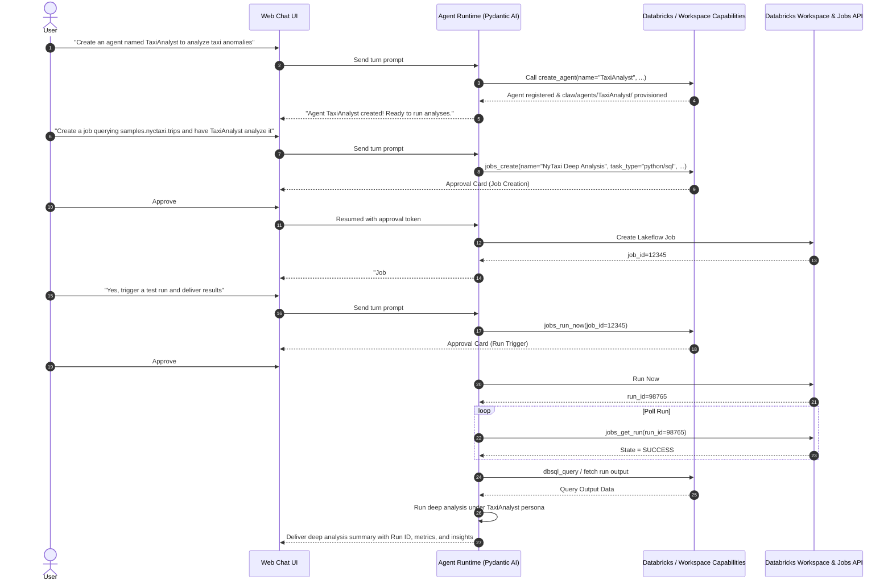

# Specification & Design: In-Chat Agent Creation and Job-Triggered Deep Analysis

## 1. Overview & Context

This document specifies the end-to-end capability for a user to perform an autonomous analytics workflow directly from the Crabriks chat interface:
1. **User asks to create a specialized agent** (e.g. "Create an agent called 'NyTaxiAnalyst' to inspect high-fare taxi patterns").
2. **System provisions the agent** both in the database store and in the physical workspace (`claw/agents/<name>/` with OpenClaw files: `AGENTS.md`, `IDENTITY.md`, `SOUL.md`, `workspace/`).
3. **User asks to create a Databricks Job** running a query on a sample dataset (e.g., `samples.nyctaxi.trips`) and triggering that agent to run a deep analysis on the query outputs.
4. **Human Approval Gate**: Creation and execution actions generate approval cards in chat.
5. **Job execution & verification**: The agent triggers a test run, tracks its progress, retrieves the result, and delivers the deep analytical summary back to the chat.

---

## 2. EARS Requirements Specification

### 2.1 Ubiquitous Requirements
- **UBIQ-01**: The system shall provide an in-chat tool capability allowing an agent to create and configure other custom agents.
- **UBIQ-02**: The system shall provision a dedicated OpenClaw-compatible workspace directory (`claw/agents/{name}/`) with `AGENTS.md`, `IDENTITY.md`, `workspace/`, and optional `SOUL.md`/`CONTEXT.md` for any agent created via chat or API.
- **UBIQ-03**: The system shall enforce human approval on all mutating job actions (`jobs_create`, `jobs_edit`, `jobs_run_now`, `jobs_cancel_run`).

### 2.2 Event-Driven Requirements
- **EVT-01**: When the user requests the creation of a new agent in chat (specifying name, role/description, instructions), the agent runtime shall invoke the `create_agent` tool to register the agent in the store and provision its workspace.
- **EVT-02**: When an agent is successfully created in chat, the system shall reply with a confirmation message including the agent's name, emoji signature, and a markdown link or reference to its workspace directory.
- **EVT-03**: When the user asks to create a Databricks Job that runs a query on a sample dataset (e.g., `samples.nyctaxi.trips`, `samples.tpch.orders`) and invokes the agent for deep analysis, the agent runtime shall prepare a job definition and request user approval via `jobs_create`.
- **EVT-04**: When the user approves the job creation, the Databricks capability shall create the job on the Databricks workspace and return the `job_id`.
- **EVT-05**: When the job is created and the user requests a test run (or immediate execution), the agent runtime shall trigger the job run via `jobs_run_now` with the necessary parameters.
- **EVT-06**: When a job run completes with status `TERMINATED` and result state `SUCCESS`, the system shall inspect the run outputs, query results, and trigger the designated agent to formulate a structured deep analysis report delivered to the chat session.

### 2.3 State-Driven Requirements
- **STATE-01**: While a job run is in `PENDING` or `RUNNING` status, the system shall expose its state via `jobs_get_run` without requiring human approval.
- **STATE-02**: While an agent is handling a turn, any tool invocation requiring approval shall pause the turn execution, record the pending tool call in Lakebase/store, and render an interactive approval card in the UI.

### 2.4 Unwanted Behavior Requirements
- **UNWANT-01**: If the user specifies an invalid or already existing agent name, then the system shall return a descriptive validation error without creating duplicate database rows or overwriting existing workspace directories.
- **UNWANT-02**: If the SQL query against the sample dataset fails syntax or permission checks, then the job execution shall report `FAILED` state, log the error details, and notify the user with actionable diagnostic feedback.
- **UNWANT-03**: If the user denies or cancels a job creation or execution request, then the system shall abort the action without making calls to the Databricks REST API.

### 2.5 Optional Feature Requirements
- **OPT-01**: Where the user specifies optional persona parameters (e.g., `soul`, `context`, custom files), the agent creation tool shall persist `SOUL.md` and `CONTEXT.md` into the agent's workspace directory.
- **OPT-02**: Where serverless execution is available in the Databricks workspace, the created job shall use serverless compute by default.

---

## 3. Architecture & Design

### 3.1 New Tools & Interfaces
1. **`create_agent` Tool** (`src/crabriks/capabilities/agent_tools.py`):
   - Parameters:
     - `name`: str (normalized identifier)
     - `description`: str
     - `system_prompt`: str
     - `signature_emoji`: str (default `"🤖"`)
     - `soul`: str | None (optional persona)
     - `context`: str | None (optional context)
   - Behavior:
     - Calls `store.create_custom_agent`
     - Calls `provision_agent_workspace(workspace_root, agent_name, ...)`
     - Injects agent into the current session agent selector if requested.

2. **Job Definition for Sample Query & Deep Analysis**:
   - Query: Uses `samples.nyctaxi.trips` (columns: `trip_distance`, `fare_amount`, `pickup_zip`, `dropoff_zip`, `tpep_pickup_datetime`).
   - Task options:
     - Databricks SQL task executing analytical query aggregating fares, outlier trips, and trip distance distributions.
     - Spark Python task invoking agent analysis or outputting analytical artifacts to volume.

3. **Approval Flow**:
   - `create_agent`: Safe internal action (no external API), no approval required.
   - `jobs_create`: Requires user approval.
   - `jobs_run_now`: Requires user approval.
   - `jobs_get_run`: Safe read action, no approval required.

---

## 4. Verification & Acceptance Criteria

1. **Agent Creation via Chat**:
   - Running a turn with prompt `Create an agent called 'NyTaxiAnalyst' with instructions 'Analyze outlier trips and high fare rates'` creates the record in Lakebase/store and creates the directory `claw/agents/NyTaxiAnalyst/` with `AGENTS.md` and `IDENTITY.md`.
2. **Job Creation with Human Approval**:
   - Calling `jobs_create` produces an approval requirement.
   - When approved, job is created on Databricks with a SQL or Python task pointing to `samples.nyctaxi.trips`.
3. **Test Run & Analytical Report**:
   - Triggering `jobs_run_now` starts run.
   - Calling `jobs_get_run` polls until completion.
   - Delivered response contains formatted analysis of trip metrics with job link and run ID.
4. **All local quality gates pass**:
   - `prek run -a` / `ruff check`, `ruff format`, `pyright`, `complexipy <= 15`.
   - `pytest` passes with 100% test success.
